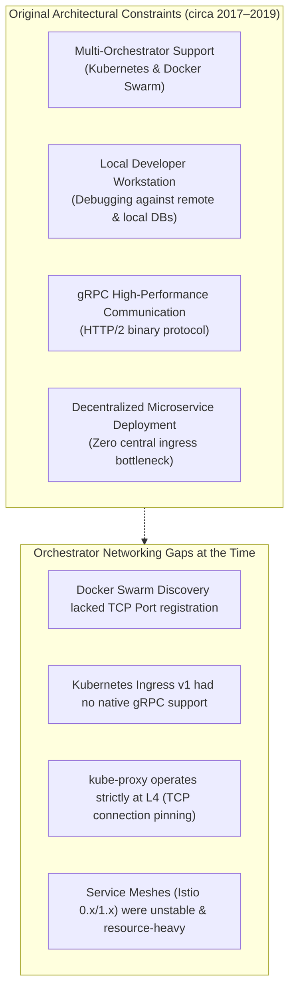
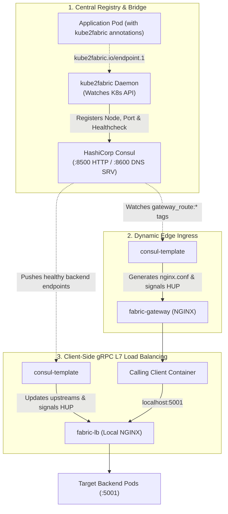

# Architecture Decision Record (ADR): Historical Rationale for Legacy Solvas Fabric Architecture

- **Status**: Accepted (Historical Context) / Superseded for Modernization
- **Date**: Retrospective Architecture Record
- **Deciders**: Solvas Platform Architecture Team
- **Context**: Solvas Fabric Distributed Microservices Stack

---

## 1. Title & Abstract

### ADR-001: Rationale for Legacy Solvas Fabric Architecture (Consul, `kube2fabric`, `fabric-gateway`, and `fabric-lb`)

This Architecture Decision Record (ADR) documents the technical context, constraints, and trade-offs that led to the original architectural design of **Solvas Fabric**. Specifically, it details:
1. Why **HashiCorp Consul** was chosen as the universal service registry.
2. Why an active synchronization controller (**`kube2fabric`** / **`kube2consul`**) was implemented.
3. Why **`fabric-gateway`** relies on Consul tags for dynamic reverse proxy routing.
4. Why **`fabric-lb`** was implemented as an in-pod NGINX sidecar driven by `consul-template` and elevated process privileges.

Understanding these historical drivers is critical for the engineering team maintaining the legacy stack and executing the cloud-native modernization towards the **Kubernetes Gateway API (Envoy Gateway)** and **Linkerd Service Mesh**.

---

## 2. Context & Problem Statement

When the Solvas Fabric platform was originally designed, enterprise requirements and the container orchestration landscape looked fundamentally different than they do today:



### 2.1 The Multi-Orchestrator Mandate (Kubernetes vs. Docker Swarm)
Fabric applications were required to run agnostically across multiple deployment targets:
- Production and staging on **Kubernetes (AKS)**.
- Alternative environments and legacy infrastructure on **Docker Swarm**.
- Local developer workstations running **Docker Desktop / Compose / Swarm**.

Standardizing directly on Kubernetes CoreDNS and native `ClusterIP` services would have created an immediate vendor lock-in to Kubernetes, preventing deployment to Docker Swarm stacks.

### 2.2 Docker Swarm Service Discovery Deficiencies
While Docker Swarm featured internal virtual IP (VIP) discovery, it had severe technical limitations:
- **No TCP Port Registration**: Swarm discovery only resolved IP addresses. It could not register or expose TCP ports. In a system where microservices host multiple dynamic or configurable endpoints (e.g., HTTP on 8080, gRPC on 5001, Metrics on 5003), clients could not dynamically discover which port to target.
- **Inability to Register External Services**: Swarm could only discover containers inside its own overlay network. It offered no mechanism to register external infrastructure, such as dedicated database clusters, on-premises message brokers, or backend services running on developer laptops outside the container network.

### 2.3 The gRPC L4 vs. L7 Load-Balancing Dilemma
Solvas standardized on gRPC for inter-service communication to achieve high throughput and low serialization latency. However, gRPC communicates over long-lived HTTP/2 TCP connections with multiplexed RPC streams:
- Orchestrator load balancers (both `kube-proxy` via iptables/IPVS and Docker Swarm ingress routing mesh) operate strictly at **L4 (TCP)**.
- When a client creates a gRPC connection to a cluster VIP, the TCP handshake completes with a single backend pod.
- All subsequent RPC calls are multiplexed over that single TCP socket indefinitely.
- As traffic spikes or backend pods scale out from 1 to 10 instances, 100% of the load remains pinned to the first pod, while 9 new replicas receive zero requests.

### 2.4 Immature Service Mesh Ecosystem
At the time this architecture was developed:
- **Istio** was in its infancy (v0.x–1.1). It was notoriously complex, memory-hungry (often requiring 1–2 GB RAM per node), prone to control-plane race conditions, and lacked operational stability.
- **Linkerd 2.x** had not yet introduced its ultra-lightweight Rust micro-proxy or stabilized its multi-protocol routing features.
- Kubernetes maintainers explicitly decided that L7 application routing would not be built into `kube-proxy`.

---

## 3. Key Architectural Decisions & Rationales



---

### Decision 1: Use HashiCorp Consul as the Universal Service Registry

#### Decision
Deploy HashiCorp Consul (`consul-registry`) as a dedicated, orchestrator-independent service catalog and DNS resolver.

#### Rationale
1. **Orchestrator Neutrality**: Consul runs identically in Kubernetes (StatefulSet) and Docker Swarm (`docker.ftbin.io/fabric/consul-kit`).
2. **First-Class Port & Metadata Support**: Consul registers service entries with IP, configurable TCP port, tags, and health-check definitions.
3. **Standard DNS SRV Interface (`:8600`)**: Consul exposes standard RFC-compliant DNS SRV records. Solvas Fabric Core .NET libraries encapsulate this in the `IServiceResolver` abstraction:
   ```csharp
   // Application code remains agnostic of container orchestrators
   var serviceEndPoint = await serviceResolver.ResolveServiceEndPointAsync("rabbitmq").ConfigureAwait(false);
   ```
4. **External Service Registration**: Pre-existing infrastructure (databases, developer endpoints) can be registered into Consul via static JSON files (`external-services.json`).
5. **Integrated Health Checking**: Consul Serf gossip protocols and active HTTP/TCP health checks automatically suppress failing pods from DNS and routing queries.

---

### Decision 2: Implement `kube2fabric` (and `swarm2consul`) as an Active Synchronization Bridge

#### Decision
Build and deploy an automated reconciliation daemon (`kube2fabric` for Kubernetes, `swarm2consul` for Swarm) to mirror container lifecycle events into the Consul catalog.

#### Rationale
1. **Zero Application-Level Coupling**: Application code should not contain vendor-specific SDKs to register or heartbeat with Consul.
2. **Declarative Metadata via Annotations**: Services declare their networking metadata directly in Helm chart pod annotations:
   ```yaml
   annotations:
     kube2fabric.io/endpoint.1: 'compliance-modeling:5001'
     kube2fabric.io/healthcheck.1: 'compliance-modeling:https url:/health interval:10s'
   ```
3. **Automated Lifecycle Synchronization**:
   - `kube2fabric` watches Kubernetes API pod events (`PodReady`, `PodTerminating`, `PodFailed`).
   - When a pod transitions to `Ready`, `kube2fabric` makes an HTTP call to `consul-http:8500` registering the pod IP, port, and health check.
   - When a pod dies or scales down, `kube2fabric` cleans up the registration, preventing stale routing.

---

### Decision 3: Drive `fabric-gateway` Ingress via Consul Service Tags

#### Decision
Implement the application edge proxy (`fabric-gateway`) using NGINX paired with `consul-template`, generating reverse-proxy routes dynamically based on service catalog tags.

#### Rationale
1. **Decentralized Route Ownership**: In traditional ingress setups, a central team must edit a monolithic ingress configuration file for every new microservice route.
2. **Self-Publishing via Tags**: In Fabric, individual development teams simply add a tag to their service registration:
   ```
   gateway_route:/api/compliance-modeling
   ```
3. **Dynamic Template Generation**:
   - `consul-template` runs as a sidecar inside `fabric-gateway`.
   - It continuously watches Consul for services bearing the `gateway_route:*` prefix.
   - It writes out dynamic NGINX `location` blocks proxying traffic to the internal endpoint and signals NGINX to reload.
4. **Decoupled Micro-Frontend Discovery**:
   - The UI composition engine (`fabric-ui-root` / Textile) leverages the same mechanism: services tag themselves with `fabric_ui`.
   - The gateway enumerates these services, allowing the single-page application shell to dynamically inject micro-frontend script bundles (`/js/main.js`).

---

### Decision 4: Implement In-Pod gRPC Load Balancing (`fabric-lb`) via `consul-template` & Shared PID Namespaces

#### Decision
Deploy a local NGINX proxy container (`fabric-nginx-lb`) alongside calling services, paired with `consul-template`, sharing the pod process namespace and granting Linux `SYS_PTRACE` capabilities.

#### Rationale
1. **Solving the gRPC L7 Imbalance**: In 2018, NGINX 1.13.10 released support for native gRPC reverse proxying (`grpc_pass`). Fabric harnessed this by placing a local NGINX instance in front of gRPC clients.
2. **Localhost Offloading**: Application clients make gRPC calls to `localhost:5001`. The local NGINX proxy terminates the HTTP/2 connection and distributes individual RPC streams across the pool of backend pod IPs using round-robin or least-connections.
3. **Continuous Upstream Maintenance**: `consul-template` watches Consul for the target backend service, regenerates the upstream IP pool in `nginx.conf`, and triggers an NGINX configuration reload.
4. **Necessity of `SYS_PTRACE` and `shareProcessNamespace: true`**:
   - Under standard Docker/Kubernetes container isolation, container processes cannot see or signal processes running in sibling containers within the same pod.
   - To avoid running NGINX and `consul-template` inside a single bloated monolithic container, Fabric configured:
     - `shareProcessNamespace: true` (merging the `/proc` tree across containers).
     - Security capability `add: [SYS_PTRACE]` on the `consul-template` container.
   - This enabled `consul-template` to execute `kill -HUP $(pidof nginx)` whenever upstream pod endpoints changed.

---

## 4. Consequences and Technical Debt

While this architecture successfully enabled cross-orchestrator deployments, dynamic routing, and L7 gRPC balancing for years, it incurred significant architectural penalties as Kubernetes matured:

### 4.1 Positive Outcomes (Historical Value)
- **Portability**: Delivered identical operational behavior across Docker Swarm, Kubernetes, and developer machines.
- **Early gRPC Adoption**: Solved the HTTP/2 connection-pinning issue long before service meshes were standard enterprise tooling.
- **Independent Deployments**: Enabled teams to plug routes and micro-frontends into the shared gateway dynamically without coordinating configuration PRs.

### 4.2 Negative Consequences & Technical Debt
1. **Dual State & Split-Brain Risks**:
   - Kubernetes tracks pod readiness in native `EndpointSlices`.
   - Fabric routing depended on an out-of-band loop: `K8s API -> kube2fabric -> Consul -> consul-template -> NGINX`.
   - If `kube2fabric` lagged, crashed, or Consul lost quorum, routing broke even though Kubernetes pods were fully healthy.
2. **Severe Pod Resource Bloat**:
   - Every gRPC-calling microservice had to run two auxiliary containers (`fabric-nginx-lb` + `consul-template`).
   - Idling NGINX master/workers and template polling agents consumed **150–250MB+ RAM per pod**. Across hundreds of pod replicas, gigabytes of cluster memory were wasted on routing plumbing.
3. **NGINX Reload Storms (`SIGHUP` Cascades)**:
   - During horizontal autoscaling or rolling rollouts, every new pod IP registration triggered `kill -HUP` across dozens of `fabric-lb` sidecars simultaneously.
   - In NGINX, `kill -HUP` spawns new worker processes while draining old ones. Under bursty churn, worker processes accumulated in memory, causing connection resets (`RST_STREAM`) and latency spikes.
4. **Security Standard Violations**:
   - `shareProcessNamespace: true` and `SYS_PTRACE` break container boundary isolation.
   - Modern Kubernetes security governance (e.g., AKS Azure Policy enforcing the `restricted` Pod Security Standard) explicitly blocks pods requesting `SYS_PTRACE`.
5. **Infrastructure Overhead**:
   - Running Consul requires maintaining stateful Raft quorum, persistent volume storage (PVCs), backup procedures, and monitoring.

---

## 5. Modern Successor Architecture (Current Direction)

The platform is actively modernizing by decommissioning the custom Consul-based plumbing in favor of native Kubernetes standards:

```mermaid
flowchart LR
    subgraph Legacy["Legacy Bespoke Fabric Stack"]
        L1["kube2fabric Daemon"]
        L2["Consul Cluster (Raft PVCs)"]
        L3["consul-template (SYS_PTRACE)"]
        L4["fabric-gateway (NGINX SIGHUP)"]
        L5["fabric-lb Sidecars (150MB+ RAM)"]
    end

    subgraph Modern["Modern Cloud-Native Standards"]
        M1["Kubernetes Native EndpointSlices"]
        M2["Kubernetes CoreDNS (:53)"]
        M3["Envoy Gateway (xDS Streaming API)"]
        M4["Gateway API (HTTPRoute / GRPCRoute)"]
        M5["Linkerd Service Mesh (Rust Micro-Proxy ~20MB)"]
    end

    Legacy -.->|"Modernized To"| Modern
```



1. **North-South (Ingress)**:
   - **Replaced**: `fabric-gateway` (NGINX + `consul-template`).
   - **Successor**: **Envoy Gateway** implementing the **Kubernetes Gateway API** (`Gateway`, `HTTPRoute`, `GRPCRoute`). Configuration updates stream in real-time via Envoy's in-memory xDS API without process reloads.
2. **East-West (Mesh & gRPC Balancing)**:
   - **Replaced**: `fabric-lb`, `consul-template`, and `kube2fabric`.
   - **Successor**: **Linkerd Service Mesh**. The lightweight Rust proxy (`linkerd-proxy`) intercepts traffic transparently, decodes HTTP/2 streams, and balances gRPC calls using EWMA latency metrics with zero application configuration and strict zero-trust mTLS.
3. **Service Discovery**:
   - **Replaced**: Consul DNS (`:8600`) and custom `IServiceResolver`.
   - **Successor**: Standard Kubernetes CoreDNS (`<service>.<namespace>.svc.cluster.local:53`) and native `EndpointSlices`.

---

## 6. Summary Matrix

| Architectural Question | Historical Decision (Legacy Fabric) | Root Justification | Modern Replacement |
|---|---|---|---|
| **Why Consul for registration?** | HashiCorp Consul cluster | Docker Swarm lacked port registration; needed cross-orchestrator and out-of-cluster discovery. | Kubernetes CoreDNS & native Endpoints |
| **Why `kube2fabric`?** | Custom Go daemon watching K8s API | Bridged Kubernetes pod readiness to Consul without requiring app-level SDKs. | Native Kubernetes API Server / kube-dns |
| **Why `fabric-gateway` uses Consul?** | NGINX + `consul-template` reading `gateway_route:*` | Allowed decentralized route ownership; services self-published routes via Consul tags. | Kubernetes Gateway API (`HTTPRoute` / `GRPCRoute`) |
| **Why `fabric-lb` uses Consul?** | In-pod NGINX sidecar reading Consul upstreams | Standard `kube-proxy` (L4) pins persistent HTTP/2 gRPC connections to a single pod. | Linkerd transparent L7 micro-proxy (EWMA) |
| **Why `SYS_PTRACE` & shared PID?** | `shareProcessNamespace: true` | Allowed `consul-template` to send `SIGHUP` to NGINX across container boundaries in the same pod. | Eliminated entirely; Envoy/Linkerd use in-memory gRPC streaming APIs |
