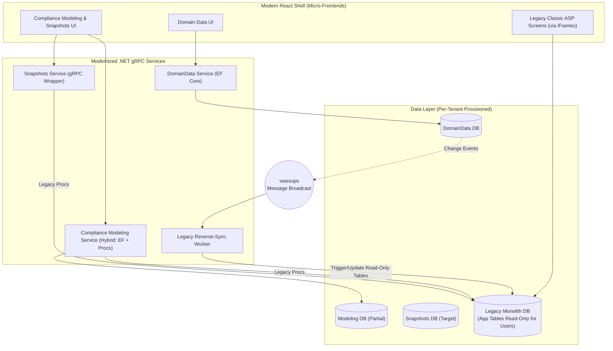
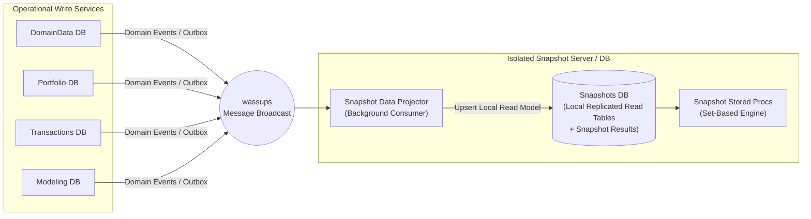

# ADR-001: Monolith Decomposition, Portfolio Service Boundaries, and Snapshot Engine Data Isolation

* **Status:** Proposed / Living Architecture Document
* **Date:** November 2026
* **Domain:** CLO Portfolio Management & Compliance Engine
* **Tech Stack:** .NET (gRPC, EF Core), React Micro-Frontends, Kubernetes, Keycloak, SQL Server, `wassups` (Message Broadcast Service)

---

## 1. Context & Problem Statement

The legacy CLO application is a monolithic Classic ASP system backed by a single, massive SQL Server database containing all business logic in complex stored procedures. Every domain—Portfolio Setup, Portfolio Maintenance, Transactions, Global Reference Data (Issuers, Issues, Facilities), Compliance Modeling, Snapshot Execution, and System/Application Metadata—resides in that single database.

### Key Architectural Drivers
1. **Workload & Performance Isolation:** Running Compliance Snapshots (heavy, set-based calculations across large datasets) on the same database server as daily portfolio operations degrades interactive user performance.
2. **Flexible Multi-Tenant Placement:** A Tenancy Service provisions a **database-per-service-per-tenant**. Deployment-time configuration dictates whether a tenant's service databases co-reside on a shared SQL Server instance or are isolated onto dedicated high-compute servers (e.g., isolating a heavy tenant's `Snapshots` or `Transactions` DB).
3. **Zero-Downtime In-Place Migration (Strangler Fig):** Existing customers rely on the legacy Classic ASP system daily. Modernization must occur incrementally without disrupting legacy operations.

---

## 2. Current Modernization Baseline (What Is Already Built)

To enable an incremental migration, the platform currently operates in a **hybrid coexistence state**:

1. **Upstream Reference Data (`DomainData` Service):**
   * **Seeding:** On deployment, a Kubernetes Job extracts upstream application/system metadata from the Legacy Monolith DB and seeds the isolated `DomainData` DB via gRPC.
   * **Source of Truth & Reverse Sync:** Legacy tables are locked to read-only for end users. Edits happen exclusively in the React UI $\rightarrow$ `DomainData` Service $\rightarrow$ `DomainData` DB. Changes publish to the **`wassups` message broadcast service**, where a dedicated Sync Service updates the legacy tables so unmigrated ASP screens remain consistent.
2. **Compliance Modeling Service (Hybrid):**
   * Modern React UI and .NET gRPC layer are live. Simple entities use EF Core in the new `Modeling` DB, while complex rule procedures still execute against the Legacy Monolith DB until refactored into C#.
3. **Snapshots Service (Wrapper):**
   * Modern React UI and gRPC orchestration exist, but underlying snapshot generation and rule execution still invoke legacy stored procedures against the Legacy Monolith DB.

---

## 3. Architectural Decisions

### Decision 1: Maintain Set-Based Snapshot Execution in SQL Server
* **Decision:** We will **not** rewrite the Snapshot calculation and compliance test execution engine into C# / EF Core. Instead, we will migrate the snapshot tables and stored procedures out of the Legacy Monolith DB into a dedicated, tenant-isolated **`Snapshots` DB**, orchestrated by the .NET `Snapshots` gRPC service.
* **Rationale:**
  * Compliance modeling (defining rules, thresholds, and sequences) is low-volume metadata CRUD—ideal for EF Core and C# domain validation.
  * Snapshot execution requires set-based aggregation across hundreds of thousands of purchase lots, transactions, ratings, and accruals. Hauling that dataset over the network into .NET memory creates severe serialization and latency bottlenecks that SQL Server handles natively.

---

### Decision 2: Right-Sizing Portfolio Service Boundaries
* **Context:** We initially considered splitting Portfolio into three services: `Organizations` (Setup & Maintenance), `Instruments` (Global Data: Issuers, Issues, Facilities), and `Transactions`. There is concern that three services may be premature or over-engineered.
* **Decision:** Adopt a **2-Service Split** (`Portfolio Core` + `Transactions`) initially, logically modularized internally so `Instruments` can be extracted later if scaling demands it.

| Service Boundary | Included Legacy Domains | Rationale |
| :--- | :--- | :--- |
| **1. `Portfolio` Service** *(Combines Setup, Maintenance & Global Master Data)* | • Portfolio Setup (Agents, Cash Accounts, Industry Classifications) • Global Data (Issuers, Issues, Facilities, Index History, Banks) • Deal Maintenance (Notes/Tranches, Hedges, CDS, Sweep Configs) | **Low-to-moderate write volume, high relational coupling.** Issues, Facilities, and Purchase Lots have tight foreign-key dependencies. Splitting `Organizations` and `Instruments` across separate databases early introduces distributed transaction headaches and chatty gRPC calls during trade entry without solving a real performance bottleneck. |
| **2. `Transactions` Service** *(Isolated High-Volume Ledger)* | • Trades & Settlements • Purchase Lots & Sale Lots • Cash Activity (Agent Receipts, Allocations, Transfers) • Facility Drawdown/Paydown Notices & Accruals | **High write volume and append-heavy growth.** Isolating `Transactions` into its own database prevents heavy trade/cash ingestion and historical ledger queries from locking or slowing down reference data and deal configuration. |

> **Design Guardrail:** Inside the `Portfolio` service, keep `Global/Instruments` and `Deal Setup/Maintenance` in separate C# namespaces/schemas (`global.*` vs `portfolio.*`). If multi-deal shared master data later requires independent scaling, it can be split out cleanly.

---

### Decision 3: Feeding the Isolated `Snapshots` Database (Solving the Data Gravity Puzzle)
* **Problem:** Once `Portfolio`, `Transactions`, `DomainData`, and `Modeling` live in separate databases (and potentially separate SQL Server instances per tenant), how does the `Snapshots` DB acquire the data required to run a compliance snapshot without making cross-database distributed queries?
* **Evaluated Options:**
  * *Option A: Synchronous gRPC Pull at Snapshot Time (Rejected).* When a user clicks "Run Snapshot," the `Snapshots` service calls `Transactions`, `Portfolio`, and `DomainData` via gRPC to bulk-fetch all data and insert it into `Snapshots` DB staging tables. *Why rejected:* Creates massive network/serialization spikes during peak compliance runs and couples snapshot availability to the runtime latency of four upstream services.
  * *Option B: Asynchronous Event-Driven Projection via `wassups` (Recommended).*

* **Decision:** Use **Asynchronous Event-Driven Replication (CQRS Read Model)** via the existing **`wassups`** message broadcast infrastructure (supplemented by a K8s initial-seed job per tenant, matching our proven `DomainData` pattern).
* **How It Works:**
  1. **Initial Seeding:** When a tenant's `Snapshots` DB is provisioned, a K8s seeding job populates the baseline read tables from the source databases.
  2. **Continuous Sync:** Whenever a trade settles (`Transactions`), a rating changes (`Portfolio`), or a rule updates (`Modeling`), the owning service publishes an event to `wassups` (using the Transactional Outbox pattern to guarantee delivery).
  3. **Local Staging Tables:** A lightweight consumer updates normalized, read-optimized tables inside the **`Snapshots` DB**.
  4. **Zero-Network Execution:** When a snapshot is triggered for an Effective Date, **100% of the data already resides locally inside the `Snapshots` DB**. The stored procedures execute at maximum native SQL speed with zero impact on the `Transactions` or `Portfolio` databases.

---

## 4. Consequences & Trade-Offs

### Positive Consequences
* **True Compute & I/O Isolation:** Heavy quarter-end compliance snapshots can run on a dedicated SQL Server instance without degrading trade capture or UI responsiveness.
* **Proven Patterns Reused:** Leverages your team's existing investments in K8s seeding jobs, `wassups` event broadcasting, and the Strangler Fig reverse-sync pattern.
* **Pragmatic Service Count:** Avoiding a premature 3-way split of Portfolio reduces distributed coordination complexity while still isolating the highest-volume workload (`Transactions`).

### Trade-Offs & Mitigations
* **Eventual Consistency Lag:** Because `Snapshots` DB is updated asynchronously via `wassups`, a user triggering a snapshot 100 milliseconds after booking a trade could miss that trade if the queue is backed up.
  * *Mitigation:* Include a lightweight **watermark/sequence check** (e.g., last processed `TransactionEventId` or timestamp) before snapshot execution. If the `Snapshots` consumer lags behind the latest committed event for that tenant, the UI/service waits briefly until caught up.
* **Storage Duplication:** Read copies of transactions and instruments exist in both their owning DB and the `Snapshots` DB.
  * *Mitigation:* Storage is inexpensive compared to compute contention, and the `Snapshots` DB only needs to project columns actually referenced by compliance rules (omitting UI audit/workflow columns).

---

## 5. Next Steps for Portfolio Modernization

1. **Inventory Snapshot Dependencies via Legacy Code Analysis:** Use the legacy SQL stored procedures (and internal RAG codebase assistant) to extract the exact list of tables and columns read by the Snapshot engine—this defines the exact schema for the `Snapshots` DB local read model.
2. **Validate `Portfolio` vs. `Transactions` Entity Map:** Map the legacy ASP/SQL tables (`Facilities`, `Issues`, `Purchase Lots`, `Cash Activity`, `Notes`) into the two target schemas to verify there are no circular write dependencies.
3. **Standardize `wassups` Outbox Schema:** Define versioned Protobuf/JSON event contracts for `Portfolio` and `Transactions` state changes so both the Legacy Reverse-Sync Worker and the Snapshot Projector can consume them cleanly.