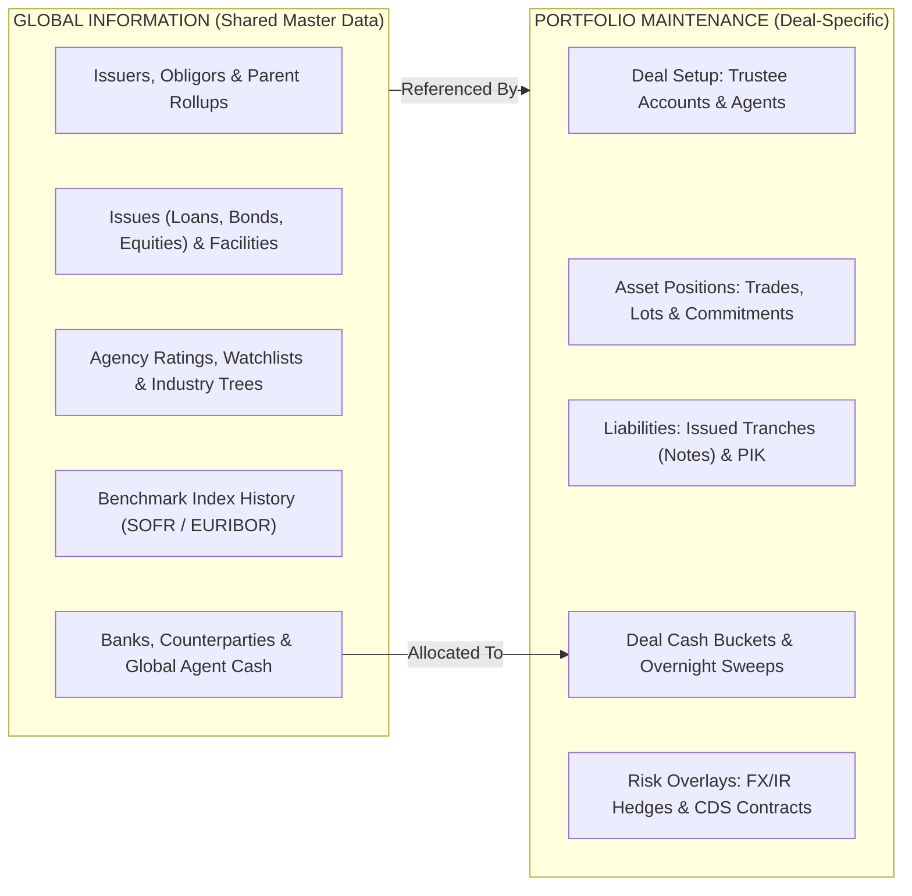
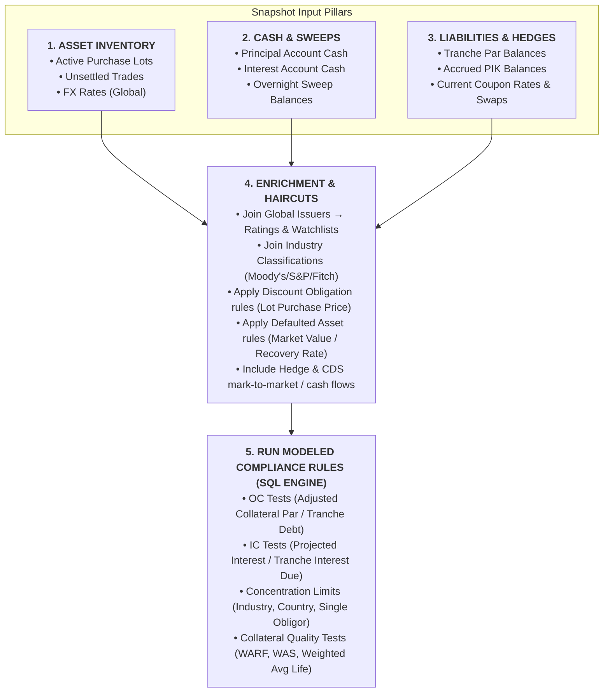

# CLO Portfolio Management: Technical & Domain Companion Guide

## Purpose of This Document

While the **CLO Reference Guide** explains *what* a CLO is at a macro level (parties, waterfalls, coverage tests), this companion guide bridges the gap between those financial concepts and the **actual data models, directories, and workflows** inside your application.

As an engineer modernizing this platform, understanding *why* these entities exist—and how they feed the snapshot and compliance engines—will help you design clean microservice boundaries, effective EF Core domain models, and reliable integration contracts.

## Architectural Mental Model: Global vs. Portfolio

In your legacy application, the separation between **Global Information** and **Portfolio Maintenance / Setup** reflects a fundamental multi-tenant financial architecture pattern:

* **Global Information (Shared Reference & Market Data):** Entities that exist in the real world independent of any single CLO deal. If *Microsoft* is downgraded by S&P, or the *SOFR* benchmark rate changes, that happens once globally and affects every CLO deal holding Microsoft debt.
* **Portfolio Setup & Maintenance (Deal-Specific Positions & Ledgers):** How a *specific* CLO deal interacts with those global entities—its specific bank accounts, the exact lots of a loan it bought, its specific hedge contracts, and its internal cash movements.

## 1. Portfolio Setup (Deal Onboarding & Infrastructure)

Before a CLO can buy assets or run compliance tests, its legal and operational plumbing must be configured.

### Agents (`contacts`, `company`)

* **What it is:** Directory of the external institutions and operational contacts involved in the deal (Trustees, Collateral Administrators, Agent Banks, Legal Counsel).
* **Connection to Reference Guide:** Maps directly to **Section 1 (CLO Parties)**. When an Agent Bank sends a fax/notice about a loan interest payment or rate reset, operations staff use these records to verify the source and route notices.

### Cash Accounts (`acc maintenance`, `wire`)

* **What it is:** The segregated bank accounts held at the Trustee for a specific CLO deal. Crucially, a CLO does not have just one bank account; it has distinct buckets—most notably the **Interest Collection Account**, **Principal Collection Account**, **Expense Reserve Account**, and **Revolver Funding Account**.
* **Connection to Reference Guide:** Essential for **Section 4 (CLO Waterfall)**. The waterfall strictly separates *Interest Proceeds* from *Principal Proceeds*. Your ledger must track cash at the account level so the compliance snapshot knows how much cash is available to pay note interest versus how much is trapped for reinvestment or deleveraging.

### Industry Classifications (`DBRS`, `Fitch`, `Moody's`, `S&P`)

* **What it is:** Standardized taxonomies mapping corporate borrowers to specific industry sectors (e.g., Moody's "Healthcare & Pharmaceuticals" vs. S&P "Health Care Providers").
* **Connection to Reference Guide:** Directly feeds **Concentration Limitations** (a core compliance rule type). A CLO indenture typically restricts exposure to any single industry (e.g., *"Max 10% in any single S&P Industry, except the largest industry may be 15%"*). Different rating agencies classify the same company differently, so the system must store all four mappings.

## 2. Global Information (The Shared Financial Universe)

These modules represent the shared master data that powers all portfolios across the platform.

### Issuers & Borrowers

* **Sub-concepts:** `collateral group types`, `issuer analyst`, `issuer issues`, `issuer deals`, `issuer ratings`, `rating watchlists`, `obligor`, `country`, `regions`.
* **What it is:** An **Issuer** (or Obligor) is the corporate entity borrowing money.
* **Why it matters:**
  * **Credit Risk & Ratings:** Rating agencies assign ratings (and watchlists/outlooks) at both the *Issuer* level and the specific *Issue* level. A downgrade or "Negative Watch" triggers haircuts in the **Overcollateralization (OC) Test** (Section 5).
  * **Parent/Subsidiary Rollups (`collateral group types`, `obligor`):** If Company A owns Company B, compliance rules aggregate their debt together to prevent the CLO from exceeding single-obligor concentration limits.

### Issues

* **Sub-concepts:** `country allocation`, `interest rate (Coupon, IR, IR Payment period)`, `issue equities/loans/securities`.
* **What it is:** The specific financial instrument issued by an Issuer (e.g., a Term Loan B, a Senior Secured Bond, or Equity warrants received during a restructuring).
* **Why it matters:** Defines the rules of the asset itself—whether it pays fixed or floating rates, its payment frequency (monthly/quarterly), its maturity date, and its seniority in bankruptcy (First Lien vs. Second Lien), which dictates **Recovery Rate** assumptions in compliance models.

### Facilities

* **Sub-concepts:** `Borrowers`, `Commitment`, `credit agreements`, `ca facilities`, `facility maintenance (loans, notice, trades, tax withholding payments)`.
* **Connection to Reference Guide:** Maps directly to **Section 2 (Loan vs. Facility)**.
* **Why it is complex:** Unlike a static bond, a syndicated **Facility** is a master credit agreement under which a borrower can draw down multiple sub-loans (contracts/tranches) at different times, in different currencies, with different interest rate periods.
  * *Tech Note:* This is why `facility maintenance` tracks `notices` (borrower requests to draw/repay) and `commitment` (total committed line vs. funded amount). Unfunded commitments require the CLO to hold cash in a dedicated reserve account to guarantee it can fund future drawdowns.

### Index History

* **What it is:** Historical daily fixings of benchmark interest rates (SOFR, EURIBOR, Prime, legacy LIBOR).
* **Connection to Reference Guide:** Powers **Section 3 (Accruals and Interest)**. Floating-rate loans pay `Index + Spread`. To calculate daily accruals or project cash flows for the **Interest Coverage (IC) Test**, the engine looks up the exact index rate for each accrual period.

### Banks & Counterparties

* **Sub-concepts:** `Accounts`, `Trading Account`, `Bank rating`, `rating outlook`, `service rating`.
* **What it is:** The financial institutions the CLO trades with (Broker-Dealers), holds cash with (Account Banks/Custodians), or enters derivative contracts with (Hedge Counterparties).
* **Why it matters:** CLO indentures enforce **Counterparty Rating Criteria**. If the bank holding the CLO's cash or providing an interest rate swap is downgraded below a required threshold (e.g., below A-1 / P-1), the CLO is legally forced to replace that bank or require them to post collateral within 30–60 days.

### Global Cash Activity & Transactions

* **Sub-concepts:** `agent receipts`, `cross portfolio cash transactions`, `cross deal transactions`, `optional transactions`.
* **What it is:** Syndicated loans are held by dozens of CLOs managed by the same firm. When an Agent Bank wires a single lump-sum interest payment or sends a restructuring notice for a loan, it arrives at the firm level (`Global`) and must be split and allocated (`cross portfolio`) down to each individual CLO deal based on their exact holdings.

## 3. Portfolio Maintenance (Deal-Level Positions & Lifecycle)

This is the core operational heart of the system—tracking what a specific CLO owns, what it owes, and every accounting event that changes its state.

### Assets (`Asset equity`, `Asset facilities`, `Asset securities`)

* **Sub-concepts:** `purchase lots`, `trades`, `transactions`, `discount obligations`, `currency exchange rates`, `commitment history`.
* **How they tie together:**
  * **Trade vs. Transaction:** A **Trade** is the agreement to buy/sell on *Trade Date* (T+0). A **Transaction** is the actual settlement and cash movement on *Settlement Date* (T+7 or T+20 for loans). Compliance engines must track both settled and unsettled trades!
  * **Purchase Lots:** If a CLO buys $2M of a loan at 99 cents on the dollar in January, and another $3M at 92 cents in March, those are stored as two distinct **Purchase Lots**.
  * **Discount Obligations:** Notice `discount obligations` under purchase lots. In a CLO indenture, if you buy a loan below a certain price threshold (e.g., < 80% of par), you are not allowed to count its full par value in the **OC Test** numerator—it is carried at its *purchase price* instead. Tracking cost basis at the *lot level* is mandatory for accurate OC calculations.

### Notes (The Liability Side)

* **Sub-concepts:** `equity`, `facility (sale lot, commitment history, int payment)`, `security (PIK, sale lot, credit opinion)`.
* **Connection to Reference Guide:** Maps to **Section 1 (Noteholders/Equity)**, **Section 6 (Note Redemption)**, and **Section 7 (PIK)**.
* **What it is:** While "Assets" are what the CLO *owns*, "Notes" are the tranches (Class A, B, C, D, Subordinated Equity) that the CLO *issued* to investors.
* **Why it matters:**
  * Tracks the current outstanding principal balance of each tranche (which shrinks during **Note Redemption / Deleveraging**).
  * Tracks **PIK (Payment-in-Kind)** capitalized interest on mezzanine tranches when a coverage test fails and cash interest is deferred.
  * Tracks **Revolving/Delayed Draw Notes** (`facility` under Notes), where investors fund the CLO in stages during its warehouse/ramp-up phase.

### Cash Activity (Deal-Level)

* **Sub-concepts:** `allocations`, `transactions`, `account transfer`, `external cash`.
* **What it is:** Moving cash between the CLO's internal buckets (e.g., transferring excess interest to principal to cure a test, or moving cash from the Collection Account to the Payment Account right before a quarterly waterfall distribution).

### Hedges & Credit Default Swaps (CDS)

* **Sub-concepts:** `notional amount`, `interest rate`, `Strike rate`, `item hedge`, `portfolio hedge`, `Counterparty pay/receive`, `credit events`, `fixed`, `floating`.
* **What it is:** Risk management derivatives used to protect the CLO against mismatches:
  * **Interest Rate Hedges (Caps/Swaps):** If the CLO owns fixed-rate bonds but pays floating-rate interest to its Noteholders, rising interest rates could cause an **IC Test failure**. A hedge swaps fixed payments for floating payments (`Counterparty pay/receive`).
  * **Currency Hedges (`item hedge`):** If a USD-denominated CLO buys a Euro-denominated loan, it enters an FX swap so currency fluctuations don't erode the collateral par value.
  * **Credit Default Swaps (CDS):** Synthetic credit protection where the CLO pays a `fixed` premium and receives a payout if a borrower suffers a `credit event` (bankruptcy/default).

### Sweep Investments

* **Sub-concepts:** `payment`, `trans`.
* **What it is:** Idle cash sitting in Trustee accounts earns almost zero interest. Overnight or between quarterly payment dates, the Trustee automatically "sweeps" idle cash into short-term, AAA-rated money market funds or commercial paper (**Eligible Investments**).
* **Why it matters:** Sweep balances count toward the **OC Test** numerator (Cash + Eligible Investments + Collateral Par) and generate extra interest income for the **IC Test**.

## 4. How It All Converges in a Compliance Snapshot

When you trigger a **Snapshot** for a specific Effective Date, the SQL Server procedures pull from every single domain area listed above to construct a frozen financial balance sheet:

### Key Takeaways for Your Modernization Effort

1. **Master Data vs. Deal Data:** `Issuers`, `Issues`, `Facilities`, `IndexHistory`, and `Banks` are **Global Master Data** services. They have high read-to-write ratios and are shared across all tenants/deals.
2. **Lot-Level Granularity is Non-Negotiable:** Never collapse asset positions into a single aggregate row per loan. Because of `Discount Obligations` and tax/accounting rules, the system *must* maintain individual `Purchase Lots` and `Sale Lots`.
3. **Trade Date vs. Settlement Date:** Your modernized Portfolio CRUD services must preserve dual-date accounting (`Trade Date` and `Settlement Date`), as compliance snapshots frequently run on a "Trade Date basis" (assuming pending trades have already settled).
4. **Why Snapshot Stays in SQL:** As shown in the convergence diagram, building a single snapshot requires joining lot-level positions, unsettled trades, multi-agency ratings, industry trees, FX rates, index histories, sweep balances, and liability tranches. Keeping that set-based aggregation in SQL Server while exposing clean, domain-driven gRPC APIs for **Portfolio Setup**, **Global Reference Data**, and **Trade/Transaction Capture** is the cleanest architectural split.