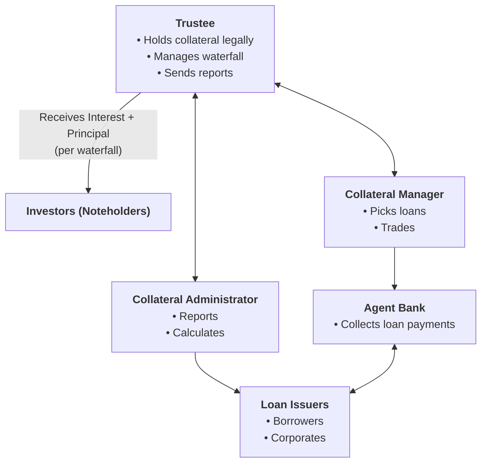
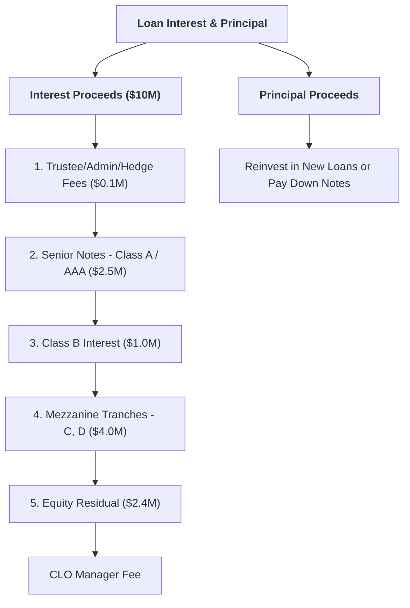
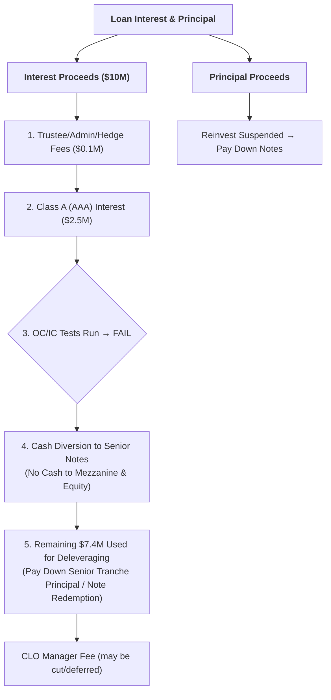
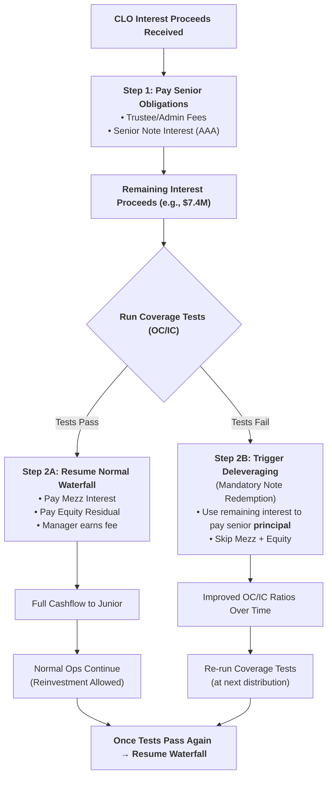

# CLO Reference Guide

This document provides a comprehensive overview of Collateralized Loan Obligations (CLOs), their structure, participants, cash flow mechanics, and risk management strategies.

---

## 1. CLO Parties and Their Roles

| Party | Role |
|-------|------|
| **Trustee** | Oversees cash flow collection/distribution, ensures compliance with legal documents, maintains official records, sends out reports, notices, and enforces terms. |
| **Collateral Manager** | Actively manages the CLO's asset portfolio (e.g., leveraged loans), executes trades, monitors credit risk, and optimizes returns for equity holders while staying within guidelines for debt tranches. |
| **Noteholders (Investors)** | Investors in the CLO's debt tranches (AAA to BB); receive interest and principal payments in a prioritized waterfall. Higher-rated notes receive lower yields but have higher payment priority. |
| **Equity Investors** | Hold the most junior tranche; receive residual cash after all debt tranches are paid. Bear the most risk but highest upside. |
| **Agent Bank (Administrative Agent)** | Administers interest and principal payments on underlying loans from borrowers — typically the agent for the syndicated loans held in the CLO. Collects loan payments from borrowers and sends them to the trustee, and maintains loan-level data such as payment schedules and outstanding balances. |
| **Rating Agencies** | Assign credit ratings to the CLO tranches; monitor performance and may upgrade/downgrade based on deal performance. |
| **Collateral Administrator** | Provides administrative services (often bundled with Trustee services). Maintains records and performance reports. |

Here’s a simplified process map of how they work together:

### Example Cash Flow Path

1. Borrowers (loan issuers) pay interest/principal → **Agent Bank**.
2. **Agent Bank** passes funds to the **Trustee**.
3. **Trustee** applies payments through the waterfall:
   > Fees → Senior Notes → Mezzanine Notes → Junior Notes → Equity.
4. **Investors** receive their distributions.
5. **Trustee** and **Administrator** send detailed reports to all parties.
6. **Collateral Manager** may trade loans or reinvest excess proceeds based on strategy.

---

## 2. Underlying Assets

CLO portfolios consist primarily of **leveraged loans**, which may be:
- **Term Loans**: Fixed amount, fixed term (usually 5–7 years), floating rate (usually LIBOR/SOFR + spread) (one accrual schedule).
- **Revolving Credit Facilities**: Commitment-based, multiple drawdowns, varying accruals.

Both term loans and facilities may be **syndicated** or **bilateral** (mostly syndicated).

### Loan vs. Facility

1. **Syndicated Loan (aka Term Loan)**
   - Fixed amount disbursed at the start.
   - Has a fixed maturity date.
   - Typically repaid in full at maturity or via scheduled amortization.
   - Single accrual stream (single interest rate applies to the whole loan).

2. **Syndicated Facility (aka Revolving Credit Facility or RCF)**
   - A committed line of credit—borrower can draw and repay as needed.
   - Not fully drawn at the start—drawdowns may vary over time.
   - Each drawdown can have a different interest period, rate, and terms.
   - Requires multiple accruals (each drawdown is tracked separately).
   - Includes commitment fees on the undrawn portion.
   - Also includes utilization fees, letter of credit sublimits, etc.

---

## 3. Accruals and Interest

- **Accrual**: The accumulation of interest owed over time, whether paid or not.
- Typically calculated as:
  $$\text{Interest} = \frac{\text{Principal} \times \text{Rate} \times \text{Days}}{360}$$

---

## 4. CLO Waterfall (Interest Proceeds)

### Scenario A — All Tests Pass

### Scenario B — Test Failure

---

## 5. Overcollateralization (OC) and Interest Coverage (IC) Tests

Each tranche has its own:
- **OC Test**:
  $$\frac{\text{Collateral Par Value}}{\text{Current Tranche} + \text{All Senior Tranche Principal}} \ge \text{OC Threshold}$$
- **IC Test**:
  $$\frac{\text{Interest Income}}{\text{Tranche Interest Due}} \ge \text{IC Threshold}$$

Failure leads to **cash flow redirection** to cure the breach (no cash to mezz/equity).

---

## 6. Note Redemption and Test Cure Lifecycle

- **Term**: **Note Redemption** = **Deleveraging** by repaying principal to top tranches
- **Purpose**: Reduce denominator in OC ratio
- No trading, no reinvestment is allowed during this time — all excess interest is redirected toward deleveraging.
- It’s a self-healing mechanism built into the CLO structure.

---

## 7. Payment-in-Kind (PIK)

PIK gives the borrower (or issuer) an option to defer the interest payment in one of these ways:
- By issuing more loan principal (in the case of a term loan), or
- By capitalizing unpaid interest, adding it to the outstanding balance.

PIK can occur:

**On Liability Side (CLO Notes)**:
- When a CLO fails a coverage test like Interest Coverage (IC) or Overcollateralization (OC). When such a test is breached, the equity and/or mezzanine tranches may not receive cash interest. Instead, interest is PIK’d—accrued and added to the balance owed. This preserves cash to pay senior noteholders.
- PIK’ing tranches is not automatic—the CLO indenture must allow it.
- It usually hurts junior noteholders—they get no cash until the test is cured.

**On Assets Side (Loans in the Portfolio)**:
- Certain loans can have a PIK feature:
  - **Optional PIK**: Borrower chooses to PIK for a period (e.g., during ramp-up, or covenant relief).
  - **Mandatory PIK / PIK Toggle**: If the borrower can’t make cash interest, the loan terms allow them to PIK automatically.
  - **Default-triggered PIK**: If the borrower misses a payment and there's no PIK provision, it’s a default.

---

## 8. Risks for Noteholders

- **Prepayment Risk**: Test failures may lead to early principal returns, ending expected interest stream.
- **Write-Down Risk**: If a tranche’s principal is permanently reduced due to collateral loss.

---

## References

**Internal**:
- [Slides](./Assets/CLO.pptx)
- [Compliance Modeling](./Assets/Compliance%20and%20PoP%20-%20Process%20Document%20(external).pdf)

**External**:
- [Guggenheim](https://www.guggenheiminvestments.com/perspectives/portfolio-strategy/understanding-collateralized-loan-obligations-clo)
- [Pinebrook](https://assets.pinebridge.com/m/11d1984b138e7339/original/pinebridge-investments_clo-primer.pdf)
- [ICG](https://www.icgam.com/wp-content/uploads/2022/02/20200603-clo-primer.pdf)
- [NAIC CMB](https://content.naic.org/sites/default/files/capital-markets-primer-collateralized-loan-obligations.pdf)