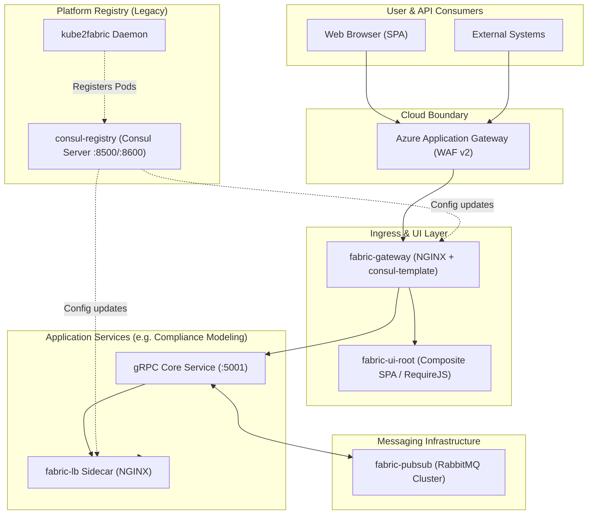
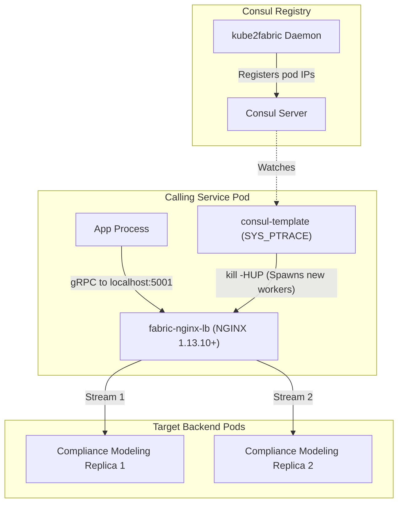
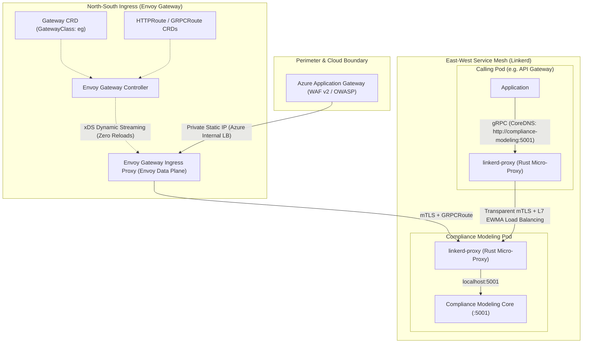
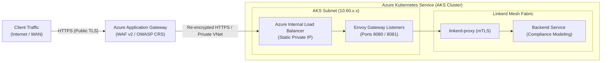
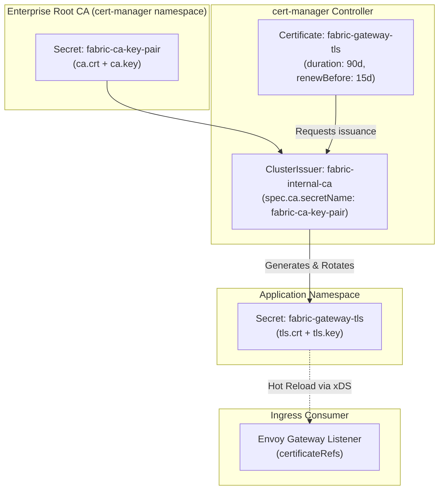

# Solvas Stack Architecture: Complete Reference (Legacy Fabric to Modernized Cloud-Native)

## 1. Executive Summary & Historical Background

The Solvas platform runs mission-critical, multi-tier financial microservices hosting both browser-facing single-page applications (SPAs) and high-throughput inter-service gRPC APIs on Kubernetes (Azure Kubernetes Service - AKS). Ingress traffic enters from enterprise users and partner networks through an Azure Application Gateway (WAF) into internal cluster endpoints, while inter-service communication (East-West) requires strict low-latency, resilient routing, and secure transport.

Historically, the Solvas platform was designed as **Solvas Fabric**—a distributed microservices framework designed to run agnostically across container orchestrators (Kubernetes and Docker Swarm) as well as developer workstations. To achieve this, Fabric composed:
- **Consul (`consul-registry`)** for service registration and DNS resolution (`:8600`).
- **Synchronization Daemons (`kube2fabric` / `kube2consul` / `swarm2consul`)** to bridge orchestrator endpoints into Consul.
- **Dynamic Ingress & Micro-Frontends (`fabric-gateway` + `fabric-ui-root` / Textile)** for plugin-based HTTP routing and composite SPA loading.
- **L7 gRPC Load Balancers (`fabric-lb` / `fabric-nginx-lb`)** to overcome the L4 limitations of container orchestrator VIPs.
- **Asynchronous Messaging (`fabric-pubsub`)** for decoupled task scheduling and event dispatch.

As the platform transitioned fully to Kubernetes and Azure Kubernetes Service (AKS), several components that originally provided orchestrator agnosticism became operational liabilities. This document serves as the comprehensive architectural reference:
1. Explaining the core subsystems of the **Legacy Solvas Fabric Application Architecture** (Service Discovery, Ingress, and L7 gRPC load balancing).
2. Documenting the rationale and mechanics of the **Modernized Kubernetes-Native Architecture** (Kubernetes Gateway API with Envoy Gateway, and Linkerd Service Mesh).
3. Detailing the migration path, architectural merits, and enterprise security pipeline (`cert-manager` and internal PKI).

---

## 2. Solvas Fabric Core Architecture & Services Map

A Solvas Fabric application is packaged as a collection of Docker images deployed as a Helm chart (in Kubernetes) or service stack (historically in Docker Swarm). The table below catalogs the core platform services and sidecars:

| Service / Component | Role & Scope | Mechanism / Technology | Modern Equivalent |
|---|---|---|---|
| **`fabric-gateway`** | Application edge entrypoint & dynamic reverse proxy | NGINX + `consul-template` watching `gateway_route:*` tags | **Envoy Gateway** (Gateway API `HTTPRoute` / `GRPCRoute`) |
| **`fabric-ui-root` / Textile** | Micro-frontend dynamic composition engine | SPA bootstrap, RequireJS / Single-SPA loading `/js/main.js` from `fabric_ui` tagged services | Modern Single-SPA / Module Federation |
| **`consul-registry`** | Central service registry & DNS resolver | HashiCorp Consul (StatefulSet / Raft) + DNS port `8600` | **Kubernetes CoreDNS & EndpointSlices** |
| **`kube2fabric` / `kube2consul`** | Orchestrator-to-Consul synchronization daemon | Watches K8s API annotations (`kube2fabric.io/*`) and registers endpoints into Consul | Native Kubernetes Controller & DNS |
| **`fabric-lb`** | L7 gRPC client-side / intermediate load balancer | NGINX 1.13.10+ gRPC proxy + `consul-template` (shared PID) | **Linkerd Service Mesh** (transparent L7 EWMA) |
| **`fabric-pubsub`** | Asynchronous messaging and task scheduling | RabbitMQ AMQP cluster + gRPC client wrappers | RabbitMQ / NATS JetStream |
| **`fabric-log`** | Centralized logging | Loki / Promtail / Fluentd | OpenTelemetry Collector + Loki |
| **`fabric-metrics`** | Metrics collection & alert infrastructure | Prometheus metrics endpoints (`:5003`/`:5004`) + Prometheus | OpenTelemetry + Prometheus / Grafana |



---

## 3. Legacy Subsystem Deep Dive

### 3.1 Service Discovery (`consul-registry` + `kube2consul` / `swarm2consul`)

#### Why Consul Was Originally Chosen Over Native Orchestrator Discovery
1. **Docker Swarm Port Deficiencies**: Docker Swarm's built-in discovery only registered virtual IP addresses, not TCP ports. Fabric services required configurable ports per endpoint.
2. **External & Local Developer Services**: Developers running services locally on laptops (or databases on dedicated physical servers) could not register them into Docker Swarm's internal discovery. Consul supported registering external nodes/services via JSON definitions.
3. **Orchestrator Agnosticism**: Standardizing on Kubernetes-native CoreDNS would have locked Fabric out of Docker Swarm. Consul served as the unified registry across both platforms.

#### DNS Resolution & Health Checking
- **Consul DNS (`:8600`)**: Consul provides a DNS interface exposing standard SRV records.
- **`IServiceResolver`**: Solvas Fabric Core .NET libraries include an `IServiceResolver` interface. Under the hood, it performs DNS SRV queries against Consul:
  ```csharp
  // Standard Fabric endpoint resolution
  var serviceEndPoint = await serviceResolver.ResolveServiceEndPointAsync("rabbitmq").ConfigureAwait(false);
  ```
- **Health Checks & Serf**:
  - `kube2consul` (and later `kube2fabric`) registers HTTP or TCP health checks into Consul based on pod annotations (`kube2fabric.io/healthcheck.1`).
  - If a service health check enters a `critical` state, Consul automatically suppresses its SRV records so DNS queries return only healthy endpoints.

---

### 3.2 Dynamic Ingress & UI Composition (`fabric-gateway` + `fabric-ui-root`)

#### Dynamic HTTP Routing via Consul Tags
Instead of maintaining a monolithic gateway routing configuration, Fabric uses a plugin-based dynamic routing model:
1. When a service deploys, it registers with Consul with the tag:
   ```
   gateway_route:<route_prefix>
   ```
2. The `fabric-gateway` deployment runs `consul-template` alongside NGINX.
3. `consul-template` queries Consul for all services with `gateway_route:*` tags and dynamically generates NGINX proxy locations forwarding to the respective internal endpoints.

#### Dynamic UI Composition Engine (`fabric-ui-root` & Textile)
The gateway exposes routing, but user interfaces require composite assembly:
- **`fabric-ui-root`**: Registers at route `/`. It provides a framework-independent bootstrapping shell for Single-Page Applications (SPA).
- **Consul Tag `fabric_ui`**: Services hosting micro-frontend components register with the `fabric_ui` tag.
- **RequireJS / Module Loading**:
  - In `fabric-ui-root`, browser JavaScript queries the gateway to enumerate all active `fabric_ui` services.
  - Using RequireJS (or in modern Fabric, Textile with SystemJS / Single-SPA importmaps), it dynamically loads `/js/main.js` from each service.
  - **Decoupled Frameworks**: Because `fabric-ui-root` only loads asset bundles, individual micro-frontends can be implemented in React, AngularJS, Vue, or Web Components without central UI recompilation.

---

### 3.3 East-West gRPC Load Balancing (`fabric-lb`)

#### The HTTP/2 Connection Pinning Problem
Because gRPC multiplexes all requests over a single long-lived TCP connection, standard L4 Kubernetes `ClusterIP` services route all traffic to the first pod selected during the TCP handshake. New pod replicas sit idle.

#### The Legacy Solution: In-Pod NGINX Sidecars
To force request-level load balancing, calling services deploy `fabric-nginx-lb`:
- Calling applications send gRPC requests to `localhost:<port>`.
- The local `fabric-nginx-lb` proxy terminates HTTP/2 and distributes individual streams across backend pod IPs.
- `consul-template` inside the pod queries Consul for healthy replicas, writes `upstream` blocks, and signals NGINX using `kill -HUP` via `SYS_PTRACE` across the shared PID namespace (`shareProcessNamespace: true`).



---

## 4. The Modernized Architecture (Gateway API + Linkerd)

The modernized architecture preserves all routing capabilities and gRPC contracts while replacing fragile, bespoke infrastructure with cloud-native standards:



### 4.1 North-South: Kubernetes Gateway API & Envoy Gateway
- Replaces `fabric-gateway` and dynamic `consul-template` NGINX reloads.
- **Role Separation**:
  - Platform team provisions the `Gateway` resource with Azure Internal Load Balancer annotations and TLS certificates.
  - Service teams define `GRPCRoute` and `HTTPRoute` manifests in their own charts.
- **xDS Dynamic Configuration**: Routing changes apply in memory across Envoy proxies without dropping connections or restarting worker processes.

### 4.2 East-West: Linkerd Service Mesh
- Replaces `fabric-nginx-lb`, `consul-template`, and `kube2fabric`.
- **Transparent gRPC Load Balancing**: The `linkerd-proxy` Rust sidecar intercepts TCP traffic, parses HTTP/2 frames, and balances gRPC calls across endpoints using **EWMA (Exponentially Weighted Moving Average)**.
- **Automatic Mutual TLS (mTLS)**: Every pod-to-pod request is automatically encrypted with ephemeral, 24-hour cryptographic identities validated against Kubernetes `ServiceAccounts`.
- **Zero Application Changes**: Workloads point directly to standard Kubernetes CoreDNS records (`http://compliance-modeling:5001`).

---

## 5. Architectural Merits: Legacy vs. Modernized Stack

```
┌─────────────────────────────────────────────────────────────────────────────┐
│                             ARCHITECTURAL MERITS                            │
├──────────────────────────────┬──────────────────────────────────────────────┤
│ 1. Resource Footprint        │ 70-80% reduction in pod memory bloat         │
│ 2. Connection Resilience     │ Dynamic xDS vs destructive SIGHUP reloads    │
│ 3. Failure Domain            │ Native K8s endpoints vs fragile Consul state │
│ 4. Security Baselines        │ Unprivileged pods vs SYS_PTRACE capabilities │
│ 5. Operational Overhead      │ Declarative CRDs vs custom bash glue scripts │
└──────────────────────────────┴──────────────────────────────────────────────┘
```

### 5.1 Resource Utilization & Pod Overhead
- **Legacy Pod Bloat**: Services using `fabric-nginx-lb` ran two auxiliary containers (`nginx` + `consul-template`), consuming 150–250MB of RAM per pod simply to route gRPC.
- **Linkerd Footprint**: `linkerd-proxy` runs as an ultra-lightweight Rust daemon consuming only **15–30MB of RAM** with sub-millisecond p99 latency overhead.
- **Consul Infrastructure Savings**: Retiring the Consul StatefulSet frees up dedicated cluster nodes, CPU, RAM, and high-performance SSD Persistent Volumes.

### 5.2 Connection Handling, Stream Multiplexing & Reload Storms
- **The Legacy Reload Storm**: When Kubernetes autoscaled pods, `kube2fabric` registered new IPs into Consul, causing every `consul-template` instance in the cluster to re-render configs and issue `kill -HUP` to NGINX. Under bursty load, old worker processes accumulated, leading to memory leaks and connection resets (`RST_STREAM`).
- **Envoy & Linkerd Smooth Updates**: Envoy and Linkerd receive endpoint updates via gRPC streaming control planes. New endpoints are added to active connection pools in memory without process reloads or packet drops.

### 5.3 Blast Radius & Failure Isolation
- **Legacy Chain of Failure**: `K8s API -> kube2fabric -> Consul -> consul-template -> NGINX`. If Consul lost quorum or `kube2fabric` crashed, service discovery failed cluster-wide.
- **Modern Resilience**: Linkerd proxies resolve endpoints directly from Kubernetes `EndpointSlice` resources. If the Linkerd control plane is temporarily unreachable, proxies continue routing traffic to healthy pods and maintaining mTLS encryption.

### 5.4 Security Posture & Compliance
- **Legacy Privileges**: `shareProcessNamespace: true` and `SYS_PTRACE` break modern Kubernetes security standards (violating the `restricted` Pod Security Standard).
- **Modern Zero-Trust**: Pods run unprivileged. Linkerd provides cryptographically validated mTLS out of the box, encrypting all node-to-node traffic across the AKS virtual network.

---

## 6. Azure Application Gateway (WAF) Integration



### 6.1 Role of the WAF
Azure Application Gateway (AAG) resides outside the cluster to terminate public TLS certificates and inspect inbound HTTP/HTTPS traffic against OWASP Top 10 vulnerabilities (SQLi, XSS, HTTP smuggling).

### 6.2 Static IP vs. Private DNS Addressing
- **Static Private IP**: The Envoy Gateway is annotated with `service.beta.kubernetes.io/azure-load-balancer-ipv4: "10.60.33.205"`, matching existing AAG backend pool definitions.
- **Dynamic Addressing via Private DNS (Alternative)**: With `ExternalDNS`, Envoy Gateway dynamically registers an `A` record in Azure Private DNS (e.g., `gateway-biz.internal.solvas.com`), allowing AAG to target an FQDN. Retaining the static IP annotation avoids altering cloud infrastructure during migration.

---

## 7. TLS Security & Certificate Lifecycle Management

### 7.1 Existing Setup vs. cert-manager
1. **Manual Static Secrets**: Certificates and private keys are currently pasted into Helm values (`tls.crt`, `tls.key`) or provisioned as static Secrets out-of-band.
2. **The "Partial" cert-manager Configuration**:
   - Templates like `core-deployment.yaml` check `Values.global.certManager.enabled`, generating a ConfigMap pointing to disk paths (`./cert/tls.crt`).
   - **Why cert-manager cannot issue certificates today**: The repository lacks the required custom resource definitions (`Issuer`, `ClusterIssuer`, and `Certificate`). Without these, cert-manager has no instructions to generate private keys or request signatures.

### 7.2 Operating cert-manager with an Internal Enterprise CA



#### Step 1: Bootstrap the Enterprise CA ClusterIssuer
```yaml
apiVersion: cert-manager.io/v1
kind: ClusterIssuer
metadata:
  name: fabric-internal-ca
spec:
  ca:
    secretName: fabric-ca-key-pair
```

#### Step 2: Declare Gateway Certificate
```yaml
apiVersion: cert-manager.io/v1
kind: Certificate
metadata:
  name: fabric-gateway-tls
  namespace: default
spec:
  secretName: fabric-gateway-tls
  duration: 2160h # 90 days
  renewBefore: 360h # 15 days before expiry
  subject:
    organizations:
      - Solvas
  isCA: false
  privateKey:
    algorithm: RSA
    encoding: PKCS1
    size: 2048
    rotationPolicy: Always
  dnsNames:
    - "gateway.internal.solvas.com"
    - "fabric-gateway"
    - "fabric-gateway.default.svc.cluster.local"
  issuerRef:
    name: fabric-internal-ca
    kind: ClusterIssuer
    group: cert-manager.io
```

### 7.3 Automated Zero-Downtime Rotation
- **Automatic Renewal**: `cert-manager` monitors expiration and signs fresh certificates before expiry.
- **Envoy Dynamic Pickup**: Envoy Gateway watches the secret via `certificateRefs`. When the secret updates, Envoy hot-reloads the TLS context in memory without dropping in-flight requests.
- **Linkerd Internal mTLS**: Linkerd automatically rotates ephemeral 24-hour pod certificates in memory without touching disk or involving application containers.

---

## 8. Complete Architecture Comparison Matrix

| Architectural Dimension | Legacy Solvas Fabric | Modernized Cloud-Native Stack |
|---|---|---|
| **Ingress Controller** | Custom NGINX + `consul-template` | **Envoy Gateway** (Gateway API) |
| **Routing Declarations** | Consul KV overrides / `gateway_route:*` tags | **`HTTPRoute` / `GRPCRoute` (K8s CRDs)** |
| **Micro-Frontend Loading** | `fabric-ui-root` (RequireJS `/js/main.js`) | **Textile / Single-SPA / Module Federation** |
| **Service Discovery** | Consul Service Catalog + `kube2fabric` | **Kubernetes CoreDNS + Endpoints** |
| **DNS Resolution** | Consul DNS (`:8600`) via `IServiceResolver` | **Kubernetes CoreDNS (`:53`)** |
| **gRPC Load Balancing** | NGINX sidecar per service (`fabric-nginx-lb`) | **Linkerd Transparent Proxy (EWMA)** |
| **Asynchronous PubSub** | `fabric-pubsub` (RabbitMQ Cluster) | **RabbitMQ / Cloud Messaging** |
| **Inter-Service Encryption** | Plaintext or manually mounted TLS certs | **Strict Zero-Trust mTLS by default** |
| **Certificate Lifecycle** | Static strings in Helm values files | **`cert-manager` + Automated CA Rotation** |
| **Pod Security Profile** | Privileged (`SYS_PTRACE`, shared PID) | **Restricted / Fully Unprivileged** |
| **Configuration Updates** | Process reload (`kill -HUP`) via sidecar | **xDS Streaming Dynamic API (No drops)** |
| **Memory Overhead** | ~150–250MB per pod (NGINX + CT + App) | **~15–30MB per pod (`linkerd-proxy`)** |
| **Cloud Portability** | Coupled to Consul and Docker Swarm legacy | **100% Kubernetes native, Cloud-agnostic** |

---

## 9. Phased Migration Strategy & Backward Compatibility

### Phase 1: Platform Dual-Mode in `fabric-helm` (Implemented)
The common platform chart (`fabric-helm`) supports both gateway models via feature flags:
- `gateway.enabled: true` + `envoyGateway.enabled: false` (Default legacy mode)
- `gateway.enabled: true` + `envoyGateway.enabled: true` (Renders Envoy Gateway resource, suppresses legacy NGINX and `consul-template`).

### Phase 2: Application Migration in Services (Implemented in Modeling)
- Application charts disable legacy `grpcLoadBalancer`:
  ```yaml
  grpcLoadBalancer:
    enabled: false
  linkerd:
    enabled: true
  ```
- Services publish `GRPCRoute` or `HTTPRoute` resources referencing the parent `Gateway`.
- Services enable Linkerd injection on deployments (`linkerd.io/inject: enabled`).

### Phase 3: Cluster-Wide Infrastructure Preparation
1. Install Gateway API standard CRDs:
   ```bash
   kubectl apply -f https://github.com/kubernetes-sigs/gateway-api/releases/download/v1.1.0/standard-install.yaml
   ```
2. Install Envoy Gateway Operator:
   ```bash
   helm install eg oci://docker.io/envoyproxy/gateway-helm --version v1.1.0 -n envoy-gateway-system --create-namespace
   ```
3. Install Linkerd CRDs & Control Plane:
   ```bash
   linkerd install-crd | kubectl apply -f -
   linkerd install | kubectl apply -f -
   ```
4. Deploy Internal CA `ClusterIssuer` for `cert-manager`.

### Phase 4: Phased Environment Cutover
1. **Local Dev / Docker Desktop**: Validate with `helm-sample-app` (NodePort bindings, Envoy Gateway, Linkerd).
2. **`dev` / `biz` Environments**: Switch values flags to `envoyGateway.enabled: true` and verify AAG-to-Envoy traffic flow.
3. **`demo` / `pre-prod` / `prod`**: Complete rollout and decommission Consul StatefulSets once all services migrate to Linkerd.
