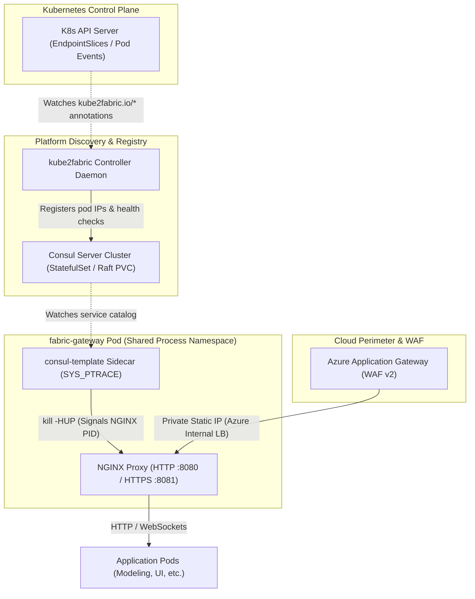
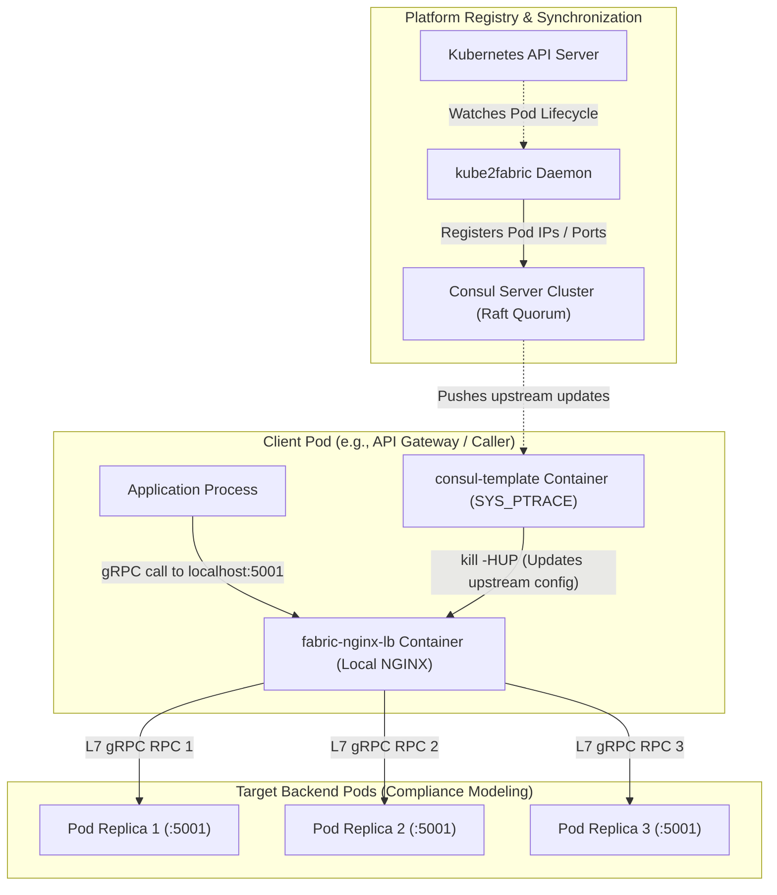
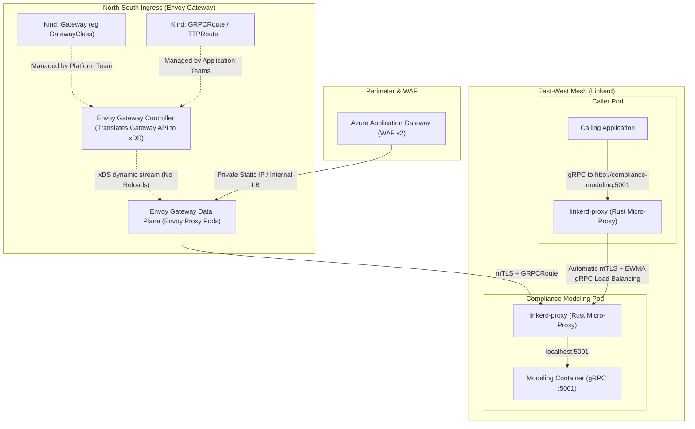
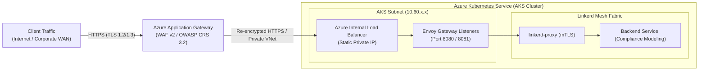
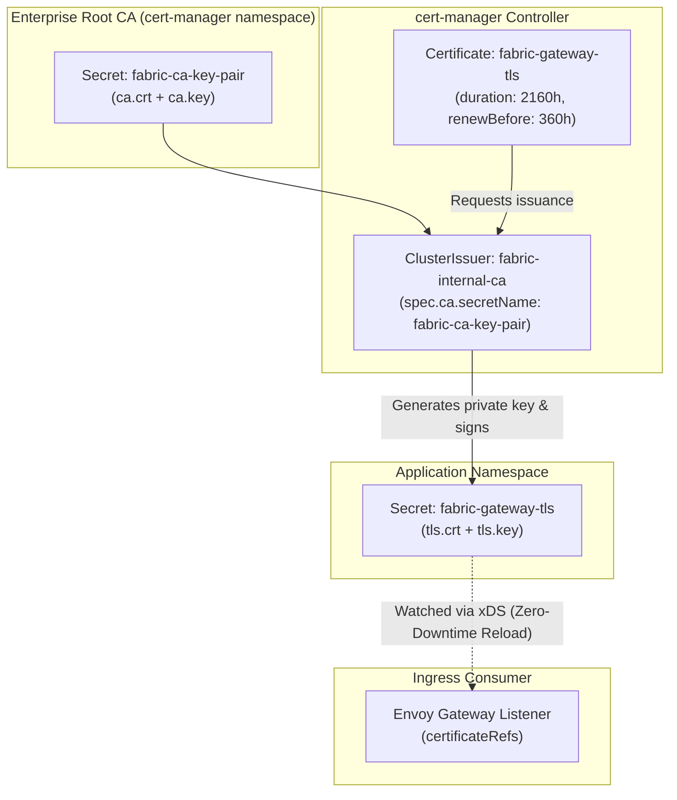

# Solvas Stack Architecture: Legacy vs. Modernized Ingress, Mesh & TLS

## 1. Executive Summary & Historical Background

The Solvas platform runs mission-critical, multi-tier financial microservices hosting both browser-facing HTTP/WebSocket applications and high-throughput inter-service gRPC APIs on Kubernetes (Azure Kubernetes Service - AKS). Ingress traffic enters from enterprise users and partner networks through an Azure Application Gateway (WAF) into internal cluster endpoints, while inter-service communication (East-West) requires strict low-latency, resilient routing and load balancing.

Historically, the Solvas platform solved service discovery, external ingress, and gRPC load balancing by composing HashiCorp Consul, custom synchronization daemons (`kube2fabric`), custom dynamic NGINX gateways, and `consul-template` sidecars. When this system was designed:
- Kubernetes native `Ingress` controllers lacked production-grade HTTP/2 and gRPC protocol support.
- Service meshes like Istio were notoriously resource-intensive, complex, and unstable.
- Kubernetes native `ClusterIP` services could not multiplex gRPC streams over persistent HTTP/2 connections, causing critical load-balancing imbalances.
- Fabric workloads spanned across both Kubernetes clusters and legacy virtual machines, making Consul an attractive central service registry.

While this bespoke architecture met early requirements, it has become a source of operational complexity, security friction (elevated container privileges, shared process namespaces), and fragile failure modes divorced from standard Kubernetes lifecycle primitives.

This reference document is designed for the platform and engineering teams maintaining and modernizing this stack. It covers:
1. **Existing Architecture Deep Dive**: How NGINX, Consul, `kube2fabric`, and `consul-template` interact for Ingress (North-South) and Mesh/Load Balancing (East-West), including historical design rationales.
2. **Modernized Architecture**: The transition to standard Kubernetes-native primitives using the **Kubernetes Gateway API (Envoy Gateway)** for North-South ingress and **Linkerd Service Mesh** for East-West mTLS and gRPC load balancing.
3. **Comprehensive Architectural Merits**: Detailed technical comparison covering CPU/memory footprints, connection draining, stream multiplexing, blast radius, and debugging ergonomics.
4. **WAF & Cloud Boundary Integration**: How Azure Application Gateway (AAG) integrates with the internal cluster ingress.
5. **TLS Security & Certificate Management**: How the existing manual certificate injection compares to an automated PKI pipeline powered by `cert-manager` and internal CAs.
6. **Backward-Compatible Migration Strategy**: Safe, phased rollout steps across shared platform charts (`fabric-helm`) and service charts (`helm-prod`).

---

## 2. Current Architecture (Legacy Stack)

The legacy architecture couples Kubernetes workloads with HashiCorp Consul via a custom synchronization bridge, relying on dynamic NGINX proxies that poll Consul for upstream configuration.



### 2.1 North-South Ingress (`fabric-gateway`)
- **Ingress Engine**: External requests enter the cluster through `fabric-gateway`, a deployment defined in `fabric-helm`.
- **Pod Composition**:
  - `nginx`: An NGINX container acting as the edge reverse proxy for HTTP, HTTPS, and WebSocket traffic.
  - `consul-template`: A companion container running inside the same pod. It queries the local Consul server for active service registrations, renders dynamic NGINX upstream definitions (`/fabric-nginx/conf.d/`), and sends a `SIGHUP` reload signal to the NGINX master process.
  - **Shared Process Namespace**: The pod configures `shareProcessNamespace: true` and grants `SYS_PTRACE` capabilities so `consul-template` can discover the NGINX PID in `/proc` and signal it across container boundaries.
- **Service Exposure**:
  - In cloud environments (`biz`, `demo`, `prod`), an internal Azure Load Balancer service (`Service` with annotation `service.beta.kubernetes.io/azure-load-balancer-internal: "true"`) exposes port 8081 (HTTPS) and 8080 (HTTP).
  - A static private IP is requested by cloud engineering and assigned via `service.beta.kubernetes.io/azure-load-balancer-ipv4`.
  - The Azure Application Gateway (WAF) targets this private static IP as its backend pool.

### 2.2 Service Discovery & Synchronization Bridge (`kube2fabric` + Consul)
- Standard Kubernetes services register endpoints with the Kubernetes API (`Endpoints` / `EndpointSlice`).
- However, legacy Solvas services do not discover each other through standard Kubernetes CoreDNS (`<service>.<namespace>.svc.cluster.local`). Instead, they rely on Consul.
- **`kube2fabric`**: A custom platform daemon that watches the Kubernetes API for pods and services decorated with `kube2fabric.io/*` annotations:
  - When a pod becomes ready, `kube2fabric` registers the pod IP and port as a node/service into Consul.
  - Health checks defined in annotations (e.g., `kube2fabric.io/healthcheck.1: 'compliance-modeling:https url:/health interval:10s'`) are converted into Consul health checks.
  - If a pod crashes or is terminated, `kube2fabric` de-registers it from Consul.

### 2.3 East-West Service-to-Service & gRPC Load Balancing (`fabric-nginx-lb`)

#### The gRPC L4 vs. L7 Problem
gRPC uses HTTP/2, which establishes a single long-lived TCP connection and multiplexes multiple concurrent requests (streams) over that connection. Standard Kubernetes `ClusterIP` services operate strictly at **L4 (TCP)**. When a client connects to a `ClusterIP` service:
1. `kube-proxy` (iptables or IPVS) routes the initial TCP handshake to one pod replica.
2. That TCP connection remains open indefinitely.
3. All subsequent gRPC calls multiplex over that single TCP connection to that single pod.
4. If you scale from 1 pod to 10 pods, the original pod continues to receive 100% of the traffic, while the 9 new pods sit idle.

#### The Legacy Solution: Per-Service NGINX Sidecars
To force L7 request-level distribution, the Solvas platform deployed an in-pod or co-located proxy called `fabric-nginx-lb`:



- In this model, the calling service sends gRPC requests to `localhost:5001` (the local `fabric-nginx-lb` proxy).
- `consul-template` watches Consul, writes an `upstream` block in NGINX configuration containing all live backend pod IPs, and sends `kill -HUP` to NGINX.
- NGINX distributes each HTTP/2 request across the backend pods using round-robin or least-connections.

### 2.4 Process Namespace Sharing & Container Signals (`SYS_PTRACE`)
To allow `consul-template` to trigger reloads of NGINX without restarting the pod:
- Pods are configured with `shareProcessNamespace: true`. This disables PID isolation between containers inside the pod.
- `consul-template` is granted Linux capability `SYS_PTRACE`.
- An entrypoint script executes `pidof nginx` across the shared PID namespace and delivers a `SIGHUP` signal.
- While effective, granting `SYS_PTRACE` breaks Kubernetes Pod Security Standards (Restricted profile) and violates zero-trust container security policies.

### 2.5 Historical Context: Why Was This Architecture Built?
To understand why this architecture exists, it helps to recall the state of Kubernetes when Solvas was originally built:
1. **Pre-Service Mesh Era**: Istio had not reached stability and was infamous for consuming gigabytes of RAM per node. Linkerd 2.x had not yet introduced its lightweight Rust proxy.
2. **Hybrid Cloud / VM Interoperability**: Fabric services originally operated across both Kubernetes and bare-metal/virtual machine environments. Consul served as the unified service discovery catalog bridging non-K8s and K8s workloads.
3. **Absence of Kubernetes Gateway API**: Ingress v1 had no native concept of gRPC routing, header manipulation, or multi-port protocol differentiation.
4. **Lack of L7 gRPC in kube-proxy**: Kubernetes core maintainers explicitly rejected adding L7 proxies into `kube-proxy`, directing users to solve gRPC load balancing either at the client library level (custom gRPC name resolvers) or via reverse proxies.

---

## 3. Modernized Architecture (Kubernetes Gateway API + Linkerd)

The modernized architecture removes all proprietary synchronization daemons and replaces them with standard Kubernetes primitives: the **Kubernetes Gateway API (Envoy Gateway)** for North-South ingress and **Linkerd Service Mesh** for East-West communication and gRPC load balancing.



### 3.1 North-South Ingress: Kubernetes Gateway API & Envoy Gateway
- **Kubernetes Gateway API (`gateway.networking.k8s.io/v1`)**: The official Kubernetes standard replacing `Ingress`. It introduces first-class resources for `Gateway`, `HTTPRoute`, and `GRPCRoute`.
- **Role Separation**:
  - **Platform Team**: Deploys the `Gateway` resource, managing listeners, ports, TLS certificates, and Azure Load Balancer IP annotations.
  - **Application Teams**: Define routing inside their own Helm charts via `GRPCRoute` or `HTTPRoute` referencing the platform `Gateway`.
- **Envoy Gateway**:
  - Powered by the CNCF Envoy proxy.
  - Subscribes to route changes and streams updates dynamically via Envoy's **xDS API**.
  - No configuration file rendering, no bash scripts, no process reloads, and zero dropped packets during route updates.

#### Application Route Manifest (`GRPCRoute`)
```yaml
apiVersion: gateway.networking.k8s.io/v1
kind: GRPCRoute
metadata:
  name: compliance-modeling-grpc-route
  namespace: default
spec:
  parentRefs:
    - name: fabric-gateway
      namespace: default
  rules:
    - matches:
        - method:
            service: compliance-modeling
      backendRefs:
        - name: compliance-modeling
          port: 5001
```

### 3.2 East-West Traffic: Linkerd Service Mesh
- **Transparent Sidecar Injection**: By setting `linkerd.io/inject: enabled` on the pod or namespace, Linkerd injects a high-performance Rust micro-proxy (`linkerd-proxy`) alongside an `initContainer` configuring `iptables`.
- **Stream-Level gRPC Load Balancing**:
  - The proxy intercepts TCP connections transparently.
  - For HTTP/2 and gRPC, it unpacks individual request streams and balances them across all pod endpoints using **EWMA (Exponentially Weighted Moving Average)** latency-based load balancing.
  - **Zero application code changes**: Services connect directly to standard Kubernetes CoreDNS addresses (`http://compliance-modeling:5001`).
- **Mutual TLS (mTLS)**: All pod-to-pod communication is automatically encrypted and mutually authenticated using ephemeral, cryptographic TLS certificates generated and rotated every 24 hours by the Linkerd identity controller.

### 3.3 What Gets Eliminated?
| Legacy Component | Modern Replacement | Result |
|---|---|---|
| `fabric-nginx/gateway` | Envoy Gateway (`Gateway`) | Dynamic xDS streaming; native Gateway API standard |
| `consul-template` | Envoy xDS + Linkerd | Eliminates `SYS_PTRACE`, shared PID, and container signaling |
| `kube2fabric` | Native K8s Endpoints / CoreDNS | Removes custom sync daemon and dual-state lag |
| Consul Server StatefulSet | K8s Control Plane + Linkerd Identity | Eliminates Raft clusters, PVC management, and disk I/O bottlenecks |
| `fabric-nginx/lb` sidecars | Linkerd Proxy (`linkerd-proxy`) | Transparent L7 balancing without per-service proxy configs |
| Consul DNS (`:8600`) | Kubernetes CoreDNS (`:53`) | Restores standard Linux/K8s resolver semantics |

---

## 4. Architectural Merits: Legacy vs. Modernized Stack

The table below breaks down the technical and operational merits of transitioning to Envoy Gateway and Linkerd:

```
┌─────────────────────────────────────────────────────────────────────────────┐
│                             ARCHITECTURAL MERITS                            │
├──────────────────────────────┬──────────────────────────────────────────────┤
│ 1. Resource Footprint        │ 70-80% reduction in pod memory bloat         │
│ 2. Connection Resilience     │ Dynamic xDS vs destructive SIGHUP reloads    │
│ 3. Failure Domain            │ Native K8s endpoints vs fragile Consul state │
│ 4. Security Baselines        │ Unprivileged pods vs SYS_PTRACE capabilities │
│ 5. Operational Overhead      │ Declarative CRDs vs custom bash glue scripts │
└──────────────────────────────┴──────────────────────────────────────────────┘
```

### 4.1 Resource Utilization & Pod Overhead
- **Legacy Pod Bloat**: In the legacy architecture, every service running `fabric-nginx-lb` required **two auxiliary containers** (`nginx` and `consul-template`). Each NGINX instance allocated master/worker memory buffers, and `consul-template` maintained active long-polling connections to Consul. Across hundreds of pod replicas, this consumed gigabytes of cluster memory and significant CPU cycles simply idling.
- **Linkerd Footprint**: `linkerd-proxy` is written in Rust and specifically engineered for minimal footprint. It typically consumes **~15–30 MB of RAM** and fractions of a CPU millicore, with sub-millisecond p99 latency overhead.
- **Consul Infrastructure Savings**: Decommissioning the Consul StatefulSet frees up dedicated CPU, RAM, and premium SSD Persistent Volumes previously allocated to Raft consensus logs.

### 4.2 Connection Handling, Stream Multiplexing & Reconfiguration Storms
- **The Legacy Reload Storm**: When Kubernetes autoscales a service (e.g., from 3 to 10 pods during a batch run), `kube2fabric` registers the 7 new IPs into Consul. Across the cluster, every `consul-template` instance detects the change, writes a new `nginx.conf`, and issues `kill -HUP`.
  - In NGINX, `kill -HUP` instructs the master process to spawn new worker processes while keeping old workers alive to drain existing connections.
  - Under bursty scaling or frequent rollouts, dozens of old worker processes accumulate in memory.
  - Active gRPC streams can experience sudden latency spikes or reset packets (`RST_STREAM`) during worker transitions.
- **Envoy Gateway & Linkerd Zero-Downtime Updates**:
  - Envoy Gateway and Linkerd proxies use dynamic gRPC control plane streams (xDS and Linkerd Destination API).
  - New endpoints are inserted directly into in-memory routing tables **without restarting processes, dropping connections, or leaking worker threads**.

### 4.3 Blast Radius, Resilience & Failure Modes
- **Legacy Dual-State Vulnerability**: Service discovery depended on an out-of-band loop: `K8s API -> kube2fabric -> Consul -> consul-template -> NGINX`. If any link in this chain broke:
  - If Consul suffered disk latency or lost Raft quorum, no service in the cluster could discover new endpoints.
  - If `kube2fabric` crashed, newly deployed pods never received traffic.
  - Stale backend IPs remained in NGINX configurations, causing requests to be blackholed into terminated pods.
- **Modern Resilient Architecture**: Linkerd and Envoy Gateway communicate directly with Kubernetes `EndpointSlice` resources. If the Linkerd control plane becomes temporarily unavailable, existing proxies continue routing traffic to known endpoints and maintain mTLS encryption without disruption.

### 4.4 Security Posture & Kubernetes Pod Security Standards
- **Legacy Privileges**: Requiring `shareProcessNamespace: true` and `SYS_PTRACE` breaks modern Kubernetes security baselines:
  - Any compromised container in the pod can inspect environment variables, read memory, and signal processes of any other container in the same pod.
  - AKS clusters enforcing the `restricted` Pod Security Standard reject these pods immediately.
- **Modern Zero-Trust**:
  - Application pods run unprivileged under `restricted` security profiles.
  - Linkerd automatically provides cryptographically verified mutual TLS (mTLS) with strict identity verification based on Kubernetes ServiceAccounts.
  - No unencrypted plaintext passes over the cluster node network.

### 4.5 Developer & Maintenance Ergonomics
- **Legacy Debugging**: Diagnosing a failed route required inspecting `kube2fabric` logs, querying Consul HTTP endpoints via curl, exec-ing into pods to inspect generated `/etc/nginx/conf.d` files, and checking `consul-template` stderr.
- **Modern Debugging**: Developers use standard Kubernetes CLI tools:
  ```bash
  kubectl get httproute,grpcroute
  kubectl describe grpcroute compliance-modeling-grpc-route
  linkerd viz stat deploy/compliance-modeling
  linkerd viz tap deploy/compliance-modeling
  ```

---

## 5. Azure Application Gateway (WAF) & Cloud Boundary Integration



### 5.1 Role of the WAF
The Azure Application Gateway (AAG) resides outside the Kubernetes cluster to inspect incoming HTTP/HTTPS traffic against OWASP Top 10 vulnerabilities (SQL injection, cross-site scripting, HTTP request smuggling).
- **Public Edge**: Terminates public SSL/TLS certificates (procured via Digicert or Azure Key Vault).
- **Cluster Ingress**: Forwards sanitized requests across the internal VNet to the internal load balancer.

### 5.2 Private Static IP vs. FQDN / Azure Private DNS
- **Current Operational Pattern**:
  1. Cloud engineering reserves a static private IP in the AKS subnet (e.g., `10.60.33.205`).
  2. The gateway Helm values annotate the service with `service.beta.kubernetes.io/azure-load-balancer-ipv4: "10.60.33.205"`.
  3. The Application Gateway backend pool targets this static IP address.
- **Dynamic Addressing via Private DNS (Alternative)**:
  - With `ExternalDNS` installed in the cluster, Envoy Gateway can dynamically acquire an internal IP and register an `A` record in Azure Private DNS (e.g., `gateway-biz.internal.solvas.com`).
  - The Application Gateway backend pool targets the FQDN rather than a raw IP address.
- **Recommendation**: Retaining the static IP annotation on the Envoy `Gateway` resource maintains parity with existing cloud automation scripts and eliminates the need to reconfigure Azure Application Gateway backend pools during initial migration.

---

## 6. TLS Security & Certificate Lifecycle Management

### 6.1 Existing Setup & Its Limitations
In the current deployment manifests:
1. **Manual Secret Injection**: Certificates and private keys are either manually pasted into Helm values (`tls.crt`, `tls.key`) or pre-created as Kubernetes Secrets out-of-band by operations scripts.
2. **Internal CA Signing**: Solvas uses an enterprise internal Root/Intermediate CA. Server certificates are signed by this CA and loaded into the pod.
3. **The "Partial" cert-manager Configuration**:
   - Templates like `core-deployment.yaml` and `cert-manager-configmap.yaml` contain conditionals checking `Values.global.certManager.enabled`:
   ```yaml
   # cert-manager-configmap.yaml
   {{- if and (.Values.enabled) (.Values.global.certManager.enabled) }}
   data:
     01-cert-manager-tls-settings.json: |-
       {
         "grpc": {
           "tls": {
             "caPath": "./cert/ca.crt",
             "crtPath": "./cert/tls.crt",
             "keyPath": "./cert/tls.key"
           }
         }
       }
   {{- end }}
   ```
   - **Why cert-manager cannot actually issue certificates today**:
     - The codebase only generates a `ConfigMap` pointing the application to disk paths.
     - **Missing**: The Kubernetes custom resources that instruct cert-manager to request and sign certificates (`Issuer`, `ClusterIssuer`, and `Certificate`).
     - Because no `kind: Certificate` manifest exists, cert-manager never receives instructions to generate private keys, issue CSRs to the internal CA, or rotate secrets.

### 6.2 How cert-manager Operates with an Internal Enterprise CA
`cert-manager` natively supports private, internal, and self-signed CAs. It does not require Let's Encrypt or external internet access.



#### Step 1: Bootstrap the Internal CA ClusterIssuer
Store the internal CA root/signing certificate and key in a protected Kubernetes secret in the `cert-manager` namespace:
```yaml
apiVersion: cert-manager.io/v1
kind: ClusterIssuer
metadata:
  name: fabric-internal-ca
spec:
  ca:
    secretName: fabric-ca-key-pair
```

#### Step 2: Declare Application or Gateway Certificates
Instead of hardcoding certificates in Helm, declare a `Certificate` manifest:
```yaml
apiVersion: cert-manager.io/v1
kind: Certificate
metadata:
  name: fabric-gateway-tls
  namespace: default
spec:
  secretName: fabric-gateway-tls
  duration: 2160h # 90 days
  renewBefore: 360h # Renew 15 days before expiry
  subject:
    organizations:
      - Solvas
  isCA: false
  privateKey:
    algorithm: RSA
    encoding: PKCS1
    size: 2048
    rotationPolicy: Always
  dnsNames:
    - "gateway.internal.solvas.com"
    - "fabric-gateway"
    - "fabric-gateway.default.svc.cluster.local"
  issuerRef:
    name: fabric-internal-ca
    kind: ClusterIssuer
    group: cert-manager.io
```

### 6.3 Automated Non-Disruptive Rotation
- **Automatic Renewal**: cert-manager continuously monitors certificate expiration. 15 days before expiry, it creates a new private key, signs the certificate against the `ClusterIssuer`, and updates the Kubernetes Secret.
- **Dynamic Envoy Pickup**: Envoy Gateway watches the referenced Kubernetes Secret (`certificateRefs`). When cert-manager updates the Secret, Envoy reloads the TLS context in memory via xDS without terminating active connections or restarting pods.
- **Linkerd Mutual TLS**: For internal East-West traffic, Linkerd handles all certificates automatically under the hood:
  - Linkerd maintains its own internal trust anchor.
  - Pod proxy certificates are ephemeral (valid for only 24 hours).
  - Rotated automatically in-memory without touching disk or requiring application awareness.

---

## 7. Architecture Comparison Matrix

| Dimension | Legacy Architecture | Modern Architecture (Target) |
|---|---|---|
| **Ingress Controller** | Custom NGINX + `consul-template` | **Envoy Gateway** (Kubernetes Gateway API) |
| **Routing Declarations** | NGINX Lua / Consul KV overrides | **`HTTPRoute` / `GRPCRoute` (K8s Standard CRDs)** |
| **East-West Discovery** | Consul Service Catalog + `kube2fabric` | **Kubernetes CoreDNS + Endpoints** |
| **gRPC Load Balancing** | NGINX sidecar per service (`fabric-nginx/lb`) | **Linkerd Transparent Proxy (EWMA algorithm)** |
| **Inter-Service Encryption** | Plaintext or manually mounted TLS certs | **Strict Zero-Trust mTLS by default** |
| **Certificate Lifecycle** | Static strings in Helm values files | **`cert-manager` + Automated CA Rotation** |
| **Pod Security Profile** | Privileged (`SYS_PTRACE`, shared PID) | **Restricted / Fully Unprivileged** |
| **Configuration Updates** | Process reload (`kill -HUP`) via sidecar | **xDS Streaming Dynamic API (Zero packet drops)** |
| **Memory Footprint** | ~150-250MB per pod (NGINX + CT + App) | **~15-30MB per pod (`linkerd-proxy`)** |
| **Observability** | Custom watchdog scripts | **Prometheus metrics + Linkerd tap/top/viz** |
| **Cloud Portability** | Coupled to Consul and Azure static IPs | **100% Kubernetes native, Cloud-agnostic** |

---

## 8. Migration Strategy & Backward Compatibility Guide

To ensure zero downtime and allow independent teams to migrate at their own cadence:

### Phase 1: Platform Dual-Mode in `fabric-helm` (Implemented)
The common platform chart (`fabric-helm`) supports both gateway models via feature flags:
- `gateway.enabled: true` + `envoyGateway.enabled: false` (Default)
  - Renders the legacy NGINX deployment, Consul KV configmaps, and static files.
- `gateway.enabled: true` + `envoyGateway.enabled: true`
  - Renders the Gateway API `Gateway` resource.
  - Automatically suppresses legacy NGINX deployments and `consul-template` resources.
  - Preserves Azure internal load balancer annotations and static IPs.

### Phase 2: Application Migration in Services (Implemented in Modeling)
- Application charts disable legacy `grpcLoadBalancer`:
  ```yaml
  grpcLoadBalancer:
    enabled: false
  linkerd:
    enabled: true
  ```
- Services publish `GRPCRoute` or `HTTPRoute` resources referencing the parent `Gateway`.
- Services enable Linkerd injection on deployments (`linkerd.io/inject: enabled`).

### Phase 3: Cluster-Wide Infrastructure Preparation
Before enabling the migration flags in staging or production environments, execute:
1. **Install Gateway API CRDs**:
   ```bash
   kubectl apply -f https://github.com/kubernetes-sigs/gateway-api/releases/download/v1.1.0/standard-install.yaml
   ```
2. **Install Envoy Gateway Operator**:
   ```bash
   helm install eg oci://docker.io/envoyproxy/gateway-helm --version v1.1.0 -n envoy-gateway-system --create-namespace
   ```
3. **Install Linkerd**:
   ```bash
   linkerd install-crd | kubectl apply -f -
   linkerd install | kubectl apply -f -
   ```
4. **Deploy Internal CA ClusterIssuer**:
   Seed the cluster with the Solvas Enterprise Root CA to allow `cert-manager` to issue TLS secrets automatically.

### Phase 4: Phased Environment Cutover
1. **Local Dev / Minikube**: Validate using `helm-sample-app` (NodePort bindings, Envoy Gateway, Linkerd).
2. **`dev` / `biz` Environments**: Switch values flags to `envoyGateway.enabled: true` and verify AAG-to-Envoy traffic flow.
3. **`demo` / `pre-prod` / `prod`**: Complete rollout and decommission Consul StatefulSets once all services migrate to Linkerd.
